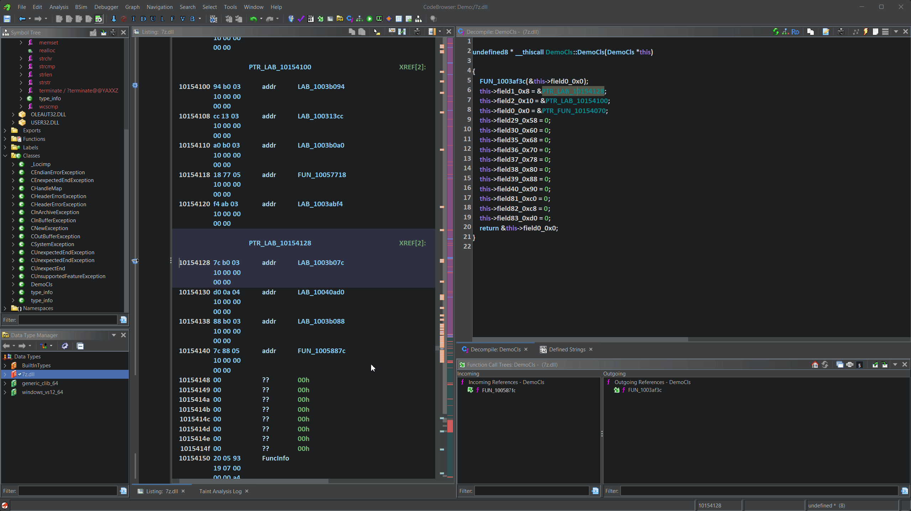
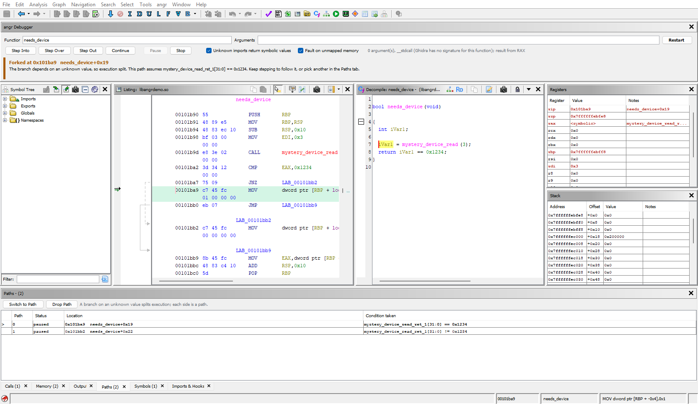
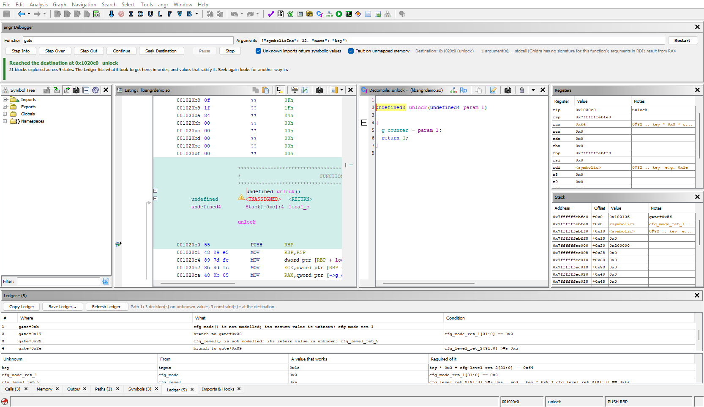
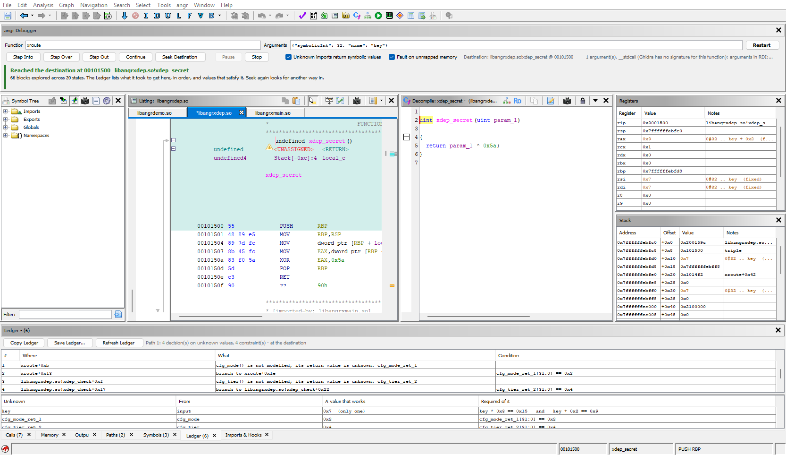

# DecompFuncUtils

A Ghidra extension that enhances the decompiler with C++ reverse engineering utilities, including VTable reconstruction, struct field navigation, and inter-procedural taint analysis.


---

## Installin The Plugin (Or Any Other Plugin)
- How to install the plugin you download from the releases.


## Features

### 🔷 Memory-to-Struct Converter
Select a memory region in the Listing view and instantly create a struct with automatic field naming based on symbol references.

**Capabilities:**
- Select any memory range containing pointers
- Automatically resolves pointer targets to symbols/functions
- Creates sanitized field names from referenced symbols
- Applies the new struct at the selection address



**Capabilities:**
- Right-click on a vtable label or DATA reference in the decompiler
- Automatically scans for valid function pointers (supports 32/64-bit)
- Creates a struct with fields named after target functions
- Handles duplicate function names with automatic suffixes
- Updates existing vtable structures when the table changes

### 🔷 Struct Field Navigation
Double-click or use `Ctrl+G` on struct field names in the decompiler to navigate directly to the referenced function or label.

**Use case:** When analyzing a vtable like `vtable->doSomething`, double-clicking on `doSomething` jumps directly to that function.

### 🔷 Data Flow Hover
Hover a variable, a called function's name, or an operator in the Decompiler to see what it is **affected by** and what it **affects** at that spot.

- **Affected by:** the named variables, constants, call results (`getenv()`), memory reads (`*ptr`) and caller-supplied arguments the value is computed from. Hovering a *read* shows the definitions that reach that particular use; hovering a declaration covers every use.
- **Affects:** the call arguments it is passed as (`memcpy() argument 3 (__n)`), memory it is stored to, the return value, branch conditions, and other variables it flows into.
- **may be modified by:** calls whose side effects can change a value that lives in memory.
- The header keeps what the hidden built-in popups would have said: the variable's data type and kind, or the callee's signature.

The search stays inside the current function, stops at the nearest named variable (hover that one to go further), and is bounded, so it never decompiles or blocks the UI. Enable the **DataflowDecompilerHoverPlugin** in *File → Configure*; turn the popup on or off under *Edit → Tool Options → Decompiler Popups → Data Flow Display*. Constants still show the scalar popup.

Agents get the same lists from the `ghidra_get_dataflow` MCP tool (see below).

### 🔷 Refined Decompiler
A second pane beside the Decompiler that shows the function under the cursor with **compiler optimizations and inlining undone**. It is a second layer of analysis over the decompiler's output: the token markup is parsed into a typed C syntax tree, the p-code gives every node its machine width and signedness, the disassembly settles what the C cannot (was this `if` a conditional move?), Z3 proves rewrites, and the emulator runs the original instructions against the refined code.

| The decompiler shows | The refined pane shows |
|----------------------|------------------------|
| `iVar1 = x + 7; if (-1 < x) iVar1 = x; return iVar1 >> 3;` | `return x / 8;` |
| `if (n != 0) { do { s = s + n % 10; b = 9 < n; n = n / 10; } while (b); }` | `while (n != 0) { s = s + n % 10; n = n / 10; }` |
| `if (a < b) b = a; return b;` | `return MIN(a, b);` |
| `l = -1; do { p = s + 1 + l; l = l + 1; } while (*p != '\0');` | `return strlen(s);` |
| `*p = 0x31554644; *(undefined4 *)(p + 1) = 0;` | `strncpy((char *)p, "DFU1", 12);` |
| three lines of `(x ^ k) * 0x1000193 >> 0x13 \| (x ^ k) * 0x326000` | `return mix(mix(mix(a, 0x811c9dc5), b), c);` |
| `if (((~x * x) & 1) == 0) { ... } else { ... }` | the branch that always runs |
| `uVar1 = decode_key(0x1234);` | `0x4ede0af8` (the callee, emulated) |

- **Every rewrite says how it was justified** — *proved* by Z3 for all inputs, *tested* by running original and replacement on the same inputs, *structural*, or *applied without a check* — and is tinted accordingly; hover it for what it replaced and the instructions behind it. A proposed rewrite that a check refutes is not applied and is listed with its counterexample.
- **The emulator has the last word:** the function's machine code and the refined C are run on the same arguments and memory, and the status line reports whether they agree.
- **Fully configurable, live.** Eleven passes that can be switched, reordered and tuned; built-in rule groups; and your own rewrite rules, one line each (`times3: ($x << 1) + $x => $x * 3`). The code updates as you change the configuration. A wrong rule costs time, not correctness: each match is verified where it is applied.

Enable **RefinedDecompilerPlugin** in *File → Configure*, then *Window → Refined Decompiler* (or right-click in the Decompiler). Nothing in the program is modified. Agents get the same engine through the `ghidra_refine_function` MCP tool. Passes, the rule language, the configuration format and the limits are described in [docs/refined-decompiler.md](docs/refined-decompiler.md).

---

## Installation

### From Release
1. Download the latest `.zip` from the [Releases](../../releases) page
2. In Ghidra: **File → Install Extensions → Add Extension**
3. Select the downloaded zip file
4. Restart Ghidra

### From Source
```bash
# Set your Ghidra installation path
export GHIDRA_INSTALL_DIR="/path/to/ghidra"

# Build the extension
gradle buildExtension
```

The built extension will be in `dist/`.

---

## Usage

### VTable Handler

1. In the Decompiler view, locate a constructor or function that references a vtable
2. Right-click on the vtable label (e.g., `PTR_LAB_10154100`)
3. Select **"Create/Update VTable Structure"**
4. Enter a name for the vtable struct
5. The plugin creates the struct and applies it at the vtable address

### Struct Field Navigation

- **Double-click** on any struct field name in the decompiler
- Or use **Ctrl+G** with the cursor on a field name
- The plugin navigates to the target function/label if found

### Memory-to-Struct Converter

1. In the Listing view, select a memory region (click and drag)
2. Right-click and select **"Create Struct from Selection"**
3. Enter a name for the new struct
4. The struct is created with pointer fields named after referenced symbols

---

## MCP Server (AI Agent Integration)

For per-data constants, variable lifetime splitting, per-use union fields, and
running scripts against the active program, see [MCP cleanup controls](docs/mcp-cleanup.md).

The plugin exposes Ghidra to AI agents over MCP. A **session manager** listens
on one fixed port (`13100`) from the moment Ghidra starts and gives every agent
session a CodeBrowser window of its own — see
[Session manager](#session-manager-one-fixed-port-13100). Each tool window also
keeps a direct port of its own (`13101` upward). Every port serves **both** MCP
transports, because different clients speak different ones:

| Endpoint | Transport | Used by |
|---|---|---|
| `POST /mcp` | Streamable HTTP (spec 2025-03-26+) | Codex, most modern clients |
| `GET /sse` + `POST /message` | Legacy HTTP+SSE (spec 2024-11-05) | Claude Code (`"type": "sse"`) |
| `GET /discovery` | Plain JSON status (not MCP) | launchers, health checks |

`initialize` negotiates the protocol revision: the server echoes the client's
requested version when it is one of `2024-11-05`, `2025-03-26`, `2025-06-18`,
and otherwise answers with the newest it supports.

### Linking imports to their shared objects

`ghidra_resolve_externals` attributes dangling `<EXTERNAL>` function symbols to
the project library that actually exports them, and stores the exporting address
in each external location so a call navigates straight into the library program.
(On Ghidra 12.3 `Library` is no longer a `Namespace`, so the attribution lives on
the external location and the symbol's parent namespace stays `Global`.)

```json
{"dryRun": true, "listSymbols": true}
```

```
{"program":"afpd","unresolvedBefore":337,"resolved":160,"withTargetAddress":160,
 "unresolvedAfter":177,
 "libraries":[{"name":"libatalk.so.18","path":"/pwnable.tw/CVE-2018-1160/libatalk.so.18",
               "status":"searched","resolved":160}]}
```

The `setAddress` half is still needed on current Ghidra: the stock resolver
attributes a namespace and never stores a target address, so even a successful
resolve leaves you unable to navigate from a call into the library.

The namespace half was needed because Ghidra's own **External Symbol Resolver**
was broken in 12.2 development builds before 17 Sep 2026 (fixed upstream, and in
the official 12.2 release). In `ExternalSymbolResolver.resolveSymbolsToLibrary`
it asked `isExportedSymbol(program, name)` where `program` is the binary being
repaired rather than the library — and `ExtLibInfo` never carried the library's
`Program` at all, because `getLibsToSearch` opened it only to record whether it
opens. The question asked was therefore "does `afpd` export `dsi_getsession`?",
which for an `UND` import is always no. On an affected build the import log
shows the libraries linking correctly and then resolving nothing:

```
  [libatalk.so.18] -> [/.../libatalk.so.18] (previously imported)
Resolving External Symbols of [/afpd] - Summary
	0 external symbols resolved, 338 remain unresolved
	[libatalk.so.18] -> /.../libatalk.so.18, 0 new symbols resolved
```

No import option changed this, since every option feeds the same predicate.
`tests/run_resolve_externals_test.ps1` reproduces it on a two-symbol ELF pair
and guards the behaviour either way.

Options: `dryRun` reports without changing anything; `setAddress` (default true)
stores the exporting address — Ghidra's own resolver does not, so even a working
resolve leaves you without cross-program navigation; `searchProject` (default
true) looks a library up in the project by file name when the import left it
unassociated, trying an exact name and then a prefix, which links a `DT_NEEDED`
of `libfoo.so.1` to a file imported as `libfoo.so.1.2.3`; `libraries` restricts
the work; `listSymbols` names what moved and what is left. It is idempotent —
re-run it as further dependencies are imported.

Prototypes are still not propagated: a resolved thunk reads
`undefined dsi_getsession()` until you give the external function a signature.
Ghidra does not carry signatures across programs in either direction.

### Cross-module references: seeing a library's callers

`ghidra_backlink_imports` makes an import navigable in **both** directions. Run
it on the importing program after `ghidra_resolve_externals`:

```json
{"dryRun": true, "listFunctions": true}
```

For every external function attributed to a project library it annotates the
exporting function *inside that library* with this program's call sites, and
bookmarks it under category `imported-by:<program>`:

```
[imported-by: afpd]
3 call sites in afpd (click to navigate):
  {@program /pwnable.tw/CVE-2018-1160/afpd@0010b2f4 afp_opensession+0x24}
  {@program /pwnable.tw/CVE-2018-1160/afpd@0010c110 dsi_stream_read+0x10}
[/imported-by: afpd]
```

**Why it is a comment and not an xref.** A Ghidra `Reference` is a from-address
and a to-address in *one* program's address factory, and the XRefs /
"Incoming References" field is built from that per-program table. There is no
cross-program reference storage, so no API can put an `afpd` call site into
`libatalk.so.18`'s incoming references — the field will stay as it is. Comment
annotations are the one link Ghidra does follow across programs:
`ProgramAnnotatedStringHandler` opens another project program and navigates to a
symbol or, failing that, a raw address. Any word after the target becomes the
rendered label, which is why a link reads `afp_opensession+0x24` rather than a
path. The bookmarks give the same set as one filterable list in the Bookmarks
window.

Call sites are found through the thunk chain — a call reaches a PLT thunk, which
thunks a stub in the synthetic `EXTERNAL` block, which thunks the external
location — so every thunk entry point is asked for its references, and the
thunk-to-thunk hops are filtered back out. Targets come from the external
location's stored address, or a name lookup in the library when no address was
stored (which is what the stock resolver leaves behind).

Each importing program owns a delimited block, so re-runs replace rather than
append and several importers of one library coexist; `remove` takes a block and
its bookmark out again. Options: `dryRun`, `remove`, `libraries`, `comments`,
`bookmarks`, `includeDataRefs` (link where the address is taken rather than
called), `maxCallSites` (default 25), `save`, `listFunctions`. Note that this
writes to and saves the **library** programs, not the current one.

If you would rather have real xrefs than annotations, the only way is one
program: import the executable, then File → Add To Program the library at a
non-overlapping base and re-point the PLT thunks with `setThunkedFunction`.
Incoming References then works natively and the decompiler follows calls into
library code, at the cost of a single merged database with no module separation.

### Cross-module linking as an analyzer

Both directions above also run inside Ghidra's own analysis, as the
**Cross-Module Import Linker** analyzer, so a program that is imported into a
project next to its libraries comes out of auto-analysis already linked, with no
tool call:

- It is on by default and appears in **Analysis → Auto Analyze…** with its
  options. It is offered only for programs that name at least one library.
- It runs last (`LOW_PRIORITY`), after disassembly, function creation and
  reference analysis have settled, because the back-link half needs the call
  sites those passes create.
- **To invoke it after analysis**, use **Analysis → One Shot → Cross-Module
  Import Linker**. That is the way to pick up a library imported into the
  project *after* this program was analyzed: the analyzer links what is in the
  project when it runs, and it runs on the importing program.
- Everything it does is idempotent. Links already made are left alone and each
  back-link block is replaced in place.

| Option | Default | Effect |
|---|---|---|
| Link imports to project libraries | on | Attribute `<EXTERNAL>` functions to the library that exports them |
| Store target addresses | on | Also store the exporting address in each external location it links |
| Search project for unassociated libraries | on | Find a library by file name when the program has no path for it |
| Write back-links into libraries | on | Write the `{@program}` call-site block and bookmark into each library |
| Back-link call sites per function | 25 | Links listed before `... and N more` |
| Save modified libraries | on | Save each library after writing into it |

The back-link half edits and saves the **library** programs. Turn *Write
back-links into libraries* off if analysis of one program must not touch
another. Headless analysis runs the analyzer too; problems (a read-only
library, a library that could not be saved) are reported in the analysis log,
routine results in the application log.

The analyzer, `ghidra_resolve_externals` and `ghidra_backlink_imports` share one
implementation (`decompfuncutils.crossmodule.CrossModuleLinker`), so they report
and do the same thing.

### Function and stack-local refinement

Use `ghidra_set_function_no_return` to set or clear a function's non-returning
attribute without replacing its signature:

```json
{"name":"fatal_error","noReturn":true}
```

Provide `address` instead of `name` to select by address. Names must match exactly
and uniquely; namespace-qualified names and external functions are supported.
For thunks, Ghidra changes the ultimate target, reported as `targetFunction` and
`targetAddress`. Pass `noReturn: false` to clear the flag. Re-decompile callers to
see the updated control flow. This changes function metadata; it does not repair
existing listing bodies or instruction flow overrides.

Use `ghidra_replace_stack_variables` to replace fragmented stack locals with
typed arrays, structures, or pointers in one transaction:

```json
{
  "functionName": "buildRequestInfo",
  "dryRun": true,
  "variables": [
    {"name":"requestBuffer","dataType":"char[64]","stackOffset":"-0x80"},
    {"name":"requestInfo","dataType":"RequestInfo","stackOffset":"-0x100"}
  ]
}
```

Create `RequestInfo` first, and use offsets and sizes recovered from your function.
`ghidra_get_function` reports `noReturn`, numeric `stackOffset` values, and local
`firstUseOffset` values. Offsets are signed Ghidra stack coordinates, not raw
instruction SP/FP displacements. Supply an integer, decimal string, or signed
`0x` hex string. `functionAddress` takes precedence over `functionName`.

The preview returns `removedVariables` and `createdVariables`. Set `dryRun` to
`false` (the default) to apply. Every persisted stack local intersecting a new
range is removed in full, including partial overlaps and locals with different
first-use offsets. New locals have first-use offset zero. Unaffected locals and
parameters are preserved; overlaps with parameters or compound storage are
rejected. Requested ranges must not overlap, and names must be unique and must
not collide with unaffected variables. A failed edit rolls back the entire batch.
Decompiler-only locals need not be committed before replacement. Re-decompile
afterwards to check the recovered layout; this tool does not split variable lifetimes.

### Refined decompilation through MCP

`ghidra_refine_function` runs the [refinement engine](docs/refined-decompiler.md) on a function
and returns the refined C, the list of rewrites with how each was justified, and the emulator's
verdict:

```json
{ "name": "hash3" }
```

```json
{
  "refined": "uint hash3(uint param_1,uint param_2,uint param_3)\n\n{\n  return mix(mix(mix(param_1, 0x811c9dc5), param_2), param_3);\n}\n",
  "summary": "8 rewrites (3 proved, 5 tested); emulator agrees on 12 runs; 36 ms",
  "rewrites": [
    { "pass": "rules", "rule": "rotl-mul", "status": "proven", "address": "00101ca5",
      "before": "(((param_1 ^ 0x811c9dc5) * 0x1000193) >> 0x13) | ((param_1 ^ 0x811c9dc5) * 0x326000)",
      "after": "rotl((param_1 ^ 0x811c9dc5) * 0x1000193, 13)", "disassembly": "..." },
    { "pass": "inline", "rule": "inlined mix", "status": "tested", "...": "..." }
  ],
  "validation": { "outcome": "agrees", "trials": 12, "agreed": 12 }
}
```

Use it instead of `ghidra_decompile_function` when the plain output is dominated by optimizer
artifacts. `proven` rewrites and an `agrees` validation can be relied on; read `assumed` ones with
care. The run is configurable per call — `disable` / `enable` / `only` take pass ids, `ruleGroups`
switches rule groups, `rules` adds rewrite rules of your own, `config` takes a whole configuration
object — and `{"describe": true}` returns the catalog of passes, parameters and rules. With
`"trace": true` the passes also say why they left a loop or a call alone.

### Local data flow through MCP

`ghidra_get_dataflow` answers "what does this depend on, and what does it feed?"
inside one function, using the same analysis as the Decompiler's Data Flow hover:

```json
{"function":"cp","variable":"__n"}
{"address":"0x001000bc"}
{"function":"cp","address":"0x001000bc","variable":"dst"}
```

Give `variable` for every use of a decompiler variable, `address` for the call
(or store, return, branch, assignment) at that instruction, or both for that
variable as read or written there. The result has `affectedBy`, `affects` and
`mayBeModifiedBy`, each entry with a `kind` (`call result`, `constant`,
`memory read`, `call argument`, `return`, `branch`, `param`, `local`, ...), a
`text`, and usually an `address`. `maxDepth` (default 8) and `maxItems`
(default 50) bound the answer; `affectedByTotal`/`affectsTotal` and the
`*Truncated` flags say when something was cut. It does not cross calls or track
values through memory: use the taint tools for that.

### Taint analysis through MCP

Call `ghidra_taint_query` with a preset to start without writing the pattern DSL:

```json
{"preset":"tainted_copy_length","maxFunctions":100}
```

The UI and MCP share a curated preset catalog. `tainted_copy_length` and
`tainted_format` remain supported aliases.

| Preset | Reports |
|--------|---------|
| `memcpy_overflow`, `memmove_overflow`, `unbounded_copy_length` | Copy length derived from input; the `unbounded` variant also requires that the length is never bounds-checked, clamped, or a plain `strlen` |
| `strcpy_overflow`, `sprintf_overflow`, `gets_usage` | Unbounded string copy / formatting of input |
| `format_string`, `fprintf_format`, `snprintf_format`, `syslog_format` | Input used as a format string (`printf`, `vprintf`, `fprintf`, `vfprintf`, `dprintf`, `sprintf`, `vsprintf`, `snprintf`, `vsnprintf`, `syslog`) |
| `format_string_buffer`, `command_injection_buffer` | A buffer built with `sprintf`/`snprintf`/`strcpy`/`strcat`/… from input, then used as a format string or run as a command |
| `command_injection`, `popen_injection`, `exec_injection` | Input reaching `system`, `popen`, or the path of `execl`/`execlp`/`execle`/`execv`/`execvp`/`execve` |
| `winexec_injection`, `shellexecute_injection`, `createprocess_injection` | Input reaching `WinExec`, `ShellExecuteA/W`, `CreateProcessA/W` |
| `alloc_mul_overflow`, `alloc_add_overflow`, `realloc_mul_overflow` | `malloc($a * $b)` / `malloc($n + const)` with an input operand and no overflow or range check |
| `alloc_copy_mismatch`, `alloc_read_mismatch` | `$p = malloc($n)` then `memcpy`/`read` into `$p` with an input length that is neither derived from nor compared with `$n` |
| `unchecked_alloc_deref`, `unchecked_alloc_use` | Result of `malloc`/`calloc`/`realloc`/`strdup` dereferenced, or passed to a copy function, without ever being compared with NULL |
| `signed_length_copy`, `signed_length_alloc` | Signed input length reaching `memcpy`/`read`/`malloc`… with no check that rejects negative values |
| `unchecked_read_length` | Return value of `read`/`recv` used as a length without any check |
| `stack_buffer_const_overflow`, `stack_buffer_const_read` | Constant length larger than the fixed-size stack array it is copied or read into |
| `realloc_misuse` | `$p = realloc($p, $n)`: the only pointer is lost when `realloc` fails |
| `toctou_file_access` | `access`/`stat`/`lstat` on a path followed by `open`/`fopen`/`unlink`/`chmod`/… on the same path |
| `use_after_free`, `use_after_free_as_arg`, `use_after_free_as_arg2`, `double_free`, `double_free_like` | Memory lifetime patterns |
| `sql_injection` | Input reaching `sqlite3_exec`, `mysql_query`, `PQexec` |

Sink presets use `tainted_ext`: the data must come from a real input source
(`getenv`, `read`, `recv`, `fgets`, `scanf`, …) — directly, through the return
value of a wrapper that returns such data, or through a buffer that an earlier
call on the path filled (`read(fd, buf, n)`) or built from tainted data
(`sprintf(cmd, "ping %s", buf)`). Buffer contents are judged at the sink, in
program order: a write that happens after the sink does not taint it, and a
later `strcpy`/`sprintf` that always runs before the sink replaces what was
there. `tainted($v)` additionally treats **every parameter of the function** as
attacker controlled; use it in a custom query for a broader, noisier sweep. In
`main`, the parameters count as external input for both.

Copy-length queries require tainted **lengths**; a fixed-size copy of input data
alone is not reported. Format queries inspect the format argument, including
shifted arguments in fortified libc calls. Lifetime presets exclude constant
pointers, require CFG reachability between matched statements, and restrict
free-like or dereferencing calls to explicitly modeled APIs. Secure CRT `_s`
functions are not matched as ordinary libc functions with different signatures.
Wrapper returns require returned-value source evidence; merely calling an input
API inside a wrapper is insufficient.

These are investigation candidates, not proof of overflow or exploitability:
destination capacity, byte-wise buffer writes, writes made by callees, the
sufficiency of a bounds check, and branch predicate feasibility are not
modeled. `unchecked`, `bounded` and `overflow_checked` look for a comparison of
the value that decides a branch anywhere in the function; they do not prove the
check is correct or covers every path. Legacy exploratory templates (hardcoded
comparisons, parameter-to-sink sweeps, statement-level truncation patterns)
remain available by name through `query`, but are omitted from the default
selector and MCP presets. Use `ghidra_find_integer_truncation` for
allocation/copy width mismatches.

#### Pattern language

A query is `PATTERN name { statements } WHERE constraints`, or just one
statement with an optional `WHERE`. Statements are matched against the
decompiled function's p-code, **in control-flow order**: each statement must be
able to execute after the previous one, whether or not `...` separates them.
Anything the parser does not understand is an error.

| Statement | Matches |
|-----------|---------|
| `f($a, _, ...)` | A call. `$a` binds a value (a second use must be the same value), `_` is any argument, `...` any remaining arguments (`f(..., $x, ...)`: some argument). `$f(...)` binds the function name. FORTIFY wrappers (`__printf_chk`, …) are matched with the plain function's argument order. |
| `f(g($x), $a * $b, $n + 16)` | Nested calls and arithmetic arguments (`+ - * / % << >> & \| ^`, operands `$var`, `_`, numbers). Matched on the value's computation, so `n = strlen(s); p = malloc(n);` matches `malloc(strlen($s))`, and `x << 3` matches `$x * 8`. |
| `$p = f(...)`, `$s = $a * $b`, `$x = $y` | Assignment of a call result, a computed value, or a copy. |
| `*$p`, `*$p = $v` | Read or write through `$p`, including `$p->field` and `$p[i]`. |
| `$p == 0`, `$n < $max` | A comparison that decides a branch. |
| `char $buf[$n]` | A local array (`$n` is its size in bytes; `[_]` for any size). |
| `...`, `...{0,5}` | A gap; optionally at most N printed statements. |
| `... not:$p=_` | Gap in which `$p` is not reassigned on the path. |
| `... not:free($p)` | Gap in which that call (with those arguments) does not execute. |
| `... not:($p == 0)`, `... guard:($p == 0)` | Gap without / with a branch on that comparison. |
| `_` | Exactly one statement in between. |

| Constraint | Meaning |
|------------|---------|
| `tainted_ext($v)` | Tainted by a real input source (see above). |
| `tainted($v)`, `tainted($v, "read")` | Also treats parameters as sources / restricts to one named source. |
| `unchecked($v)` | The value never reaches a comparison that decides a branch (for pointers: a comparison with a constant such as NULL). Follows the value through copies, casts and phi nodes, so it does not depend on where the decompiler prints the check. |
| `bounded($v)` | The value reaches an ordered comparison (`<`, `<=`, …), or is a `min()`-style merge of bounded values. |
| `nonneg_checked($v)` | A branch rejects negative values (signed comparison with 0/1/-1, or any unsigned comparison). |
| `overflow_checked($a, $b)`, `overflow_checked($n)` | Every non-constant operand is bounded, or a division / carry test guards the computation. |
| `signed($v)` | The value is sign-extended, or is a variable of a signed integer type. |
| `same($a, $b)` | The same value, ignoring casts and integer extensions. |
| `related($a, $b)` | One is computed from the other, both read the same location or call the same function on the same arguments, or they are compared with each other. |
| `returned_by($v, "strlen", …)` | The value is (computed from) the result of one of these calls. |
| `const_eq($a, 16)`, `const_ne`, `const_lt`, `const_le`, `const_gt`, `const_ge` | Compare a constant binding with a number or another binding (unsigned). |
| `in_loop()`, `in_loop($v)` | The last matched statement / the statement that matched `$v` is inside a loop. |
| `function_in($f, "a", "b")`, `function_is($f, "a")` | The bound function name is one of these (wrapper prefixes ignored). |
| `flows_to($a, $b)`, `is_constant($v)`, `is_param($v)`, `is_local($v)` | Data flow and value kind. |

Combine constraints with `AND`, `OR`, `NOT` and parentheses. Examples:

```text
PATTERN cmd { snprintf($buf, _, ...); ...; system($buf); } WHERE tainted_ext($buf)
malloc($a * $b) WHERE tainted_ext($a) AND NOT overflow_checked($a, $b)
PATTERN nullderef { $p = malloc(_); ... not:$p=_; *$p; } WHERE unchecked($p)
PATTERN stack { char $buf[$size]; read(_, $buf, $len); } WHERE const_gt($len, $size)
```

Each match reports the first matched statement (`matchAddress`) and the last
one (`sinkAddress`, `sinkCode`), plus a `trace` with one line per matched
statement; `matchedCode` shows both ends.

Provide either `preset` or `query`, never both. To focus on one function:

```json
{"preset":"tainted_format","functionName":"fmt"}
```

For a custom source-specific query:

```json
{"query":"PATTERN p { printf($fmt); } WHERE tainted($fmt, \"getenv\")","maxFunctions":100}
```

For each page, inspect `functionsScanned` (attempted), `functionsAnalyzed`
(successful), and `failures` (addresses and reasons). When `truncated` is true,
pass `nextStartAfter` as `startAfter` with the same query and limit to continue.
Keep the program unchanged while paging. Retry failed functions individually
using `functionAddress`, optionally with a longer `decompileTimeout`.
`complete` reports coverage of the requested scope/page remainder; an empty
match list does not prove safety. Pointer writes, aliases, indirect calls, and
interprocedural source reachability remain approximate.

Use `ghidra_taint_forward` or `ghidra_taint_backward` with `functionName`,
`variableName`, and `maxDepth` to investigate a candidate further. Query results
include function and match addresses so you can decompile or navigate directly
to the finding using the existing MCP tools.

### Symbolic branch analysis and emulation

Use `ghidra_suggest_branch_flip` with a `branchAddress` to obtain concrete
witnesses for a local decompiler predicate. Supported shapes are same-width
integer comparisons against constants and masked equality/inequality.
`trueFeasible` and `falseFeasible` describe that predicate alone; an empty
witness list means that direction is impossible for the supported shape.
Witnesses use unsigned hex bit patterns, including signed negative values.
Width-changing casts, computed inputs, and masked inequalities return
`supported: false`. Earlier path constraints are not solved.

Use `ghidra_emulate_function` to verify candidates with seeded `registers`,
`memory`, and `stackPointer`. Enable `recordBranches` and `symbolicBranches`
to inspect the concrete path alongside decompiler expressions. `pcAtStop`
reports the final execution address, including when `maxSteps` is exhausted;
a breakpoint reached by the last allowed step takes precedence over the limit.
`branchCount` and `skippedCallCount` count all observations even when their
returned lists are truncated. Expression depth must be 1–64 and `maxSteps`
must be positive (capped at 2,000,000).

Re-emulate local branch witnesses to check reachability and machine-branch
direction. Skipped external calls do not model callee side effects.

The emulator also reports what a run silently depended on, and bounds it:

- `uninitializedReads` lists memory that was read before anything wrote it
  (address, size, and the instruction that read it). The emulator treats such
  bytes as zero, so this list is what to seed when a result looks wrong.
- `timeoutMs` (default 30000, max 600000) stops a run by wall clock with
  `stopReason: "timeout"`, for loops that would otherwise burn the step budget.
- `readMemory` takes up to 16 `{address, length}` ranges (length ≤ 1024) and
  returns their bytes at the stop point in `memoryAtStop`.
- `skipAllCalls` steps over every call, internal ones included, and
  `callReturnValues` supplies the value each skipped call returns, in execution
  order. This replays a witness that `ghidra_explore_paths` found with
  `callPolicy: "skip"`, and lets one function be run in isolation.

### Calling a function with angr

`ghidra_angr_emulate` runs a function of the open program under
[angr](https://angr.io) and reports what it did. Where `ghidra_emulate_function`
starts from raw machine state - registers, a stack pointer, a return sentinel,
hex buffers at addresses you pick - this one is called like the function itself:

```json
{"function": "check_password", "args": ["letmein"]}
```

```json
{
  "function": "check_password @ 001019a0",
  "called": "1 argument(s), __stdcall (Ghidra has no signature for this function); arguments in RDI; result from RAX",
  "outcome": "returned",
  "returnValue": {"hex": "0x0", "signed": 0},
  "calls": [{"call": "strcmp", "args": ["0x620000000100 \"letmein\"", "0x100660 \"hunter2\""],
             "returned": "0x1", "from": "0x1019b7 (check_password+0x17)", "depth": 1}]
}
```

Ghidra contributes what it already knows and angr does the executing:

- **The function** is given by name or address.
- **Argument and result locations come from Ghidra** - the function's own
  parameter storage where it has a signature, the calling convention's
  assignment where it does not - so stack arguments, Windows x64, `thiscall`
  and custom storage behave the way the decompiler shows them. `called` states
  what was assumed. The stack and return address are set up for you.
- **The memory image is Ghidra's**, exported as-is. Addresses in results are
  Ghidra addresses, patches and relocations applied in Ghidra are in effect,
  and anything Ghidra can load can be run; the original file is never opened.
- **Imports run as angr's models** (`malloc`, `strlen`, `memcpy`, `printf`, ...),
  hooked at the thunk addresses Ghidra resolved, or as the
  [Python hooks](#python-hooks) you wrote for them. An import with neither does
  nothing, returns 0 (`unmodelledImports: "symbolic"` for an unknown value
  instead), and is listed in `unmodelledExternals`. The libraries themselves do
  not need to be in the project.
- **Each call starts from the program's own memory.** Nothing carries over
  between calls.

Arguments are written as plain values:

| Form | Meaning |
|---|---|
| `5`, `-1`, `"0x1F"` | integer (a string that reads as a hex literal is the integer) |
| `"text"` | pointer to that NUL-terminated string (`{"string": "0x1F"}` for text that looks like hex) |
| `{"bytes": "deadbeef"}` | pointer to those bytes |
| `{"buffer": 64}` | pointer to 64 zero bytes, for an out-parameter |
| `{"struct": [3, 4, "label"]}` | pointer to a packed struct: integers are 4 bytes unless `{"int": v, "size": n}`, strings/buffers/structs become pointer fields, `{"pad": n}` and `{"raw": "hex"}` control layout |
| `{"symbolicBytes": 16}`, `{"symbolicInt": 32}` | unknown input, to be solved for (below) |

What comes back, when present: `returnValue` (hex, signed, and the string it
points at if it is one), `stdout`/`stderr`, `buffers` (final contents of every
pointer argument, with `changed`), `globalWrites` (writes into the program's own
data, with the symbol), `calls` (nested by `depth`; library calls with their
arguments and result, strings shown inline), and `memory` for `readMemory`
ranges. `memory` seeds data before the call and takes a symbol name as the
address, e.g. `[{"address": "g_config", "int": 1, "size": 4}]`; `registers` sets
anything that is not an ordinary argument; `stubs` gives any function, internal
or imported, a fixed result: `{"check_license": 1, "getuid": 0}`.

A pointer the function follows but nobody supplied is a **fault**, not a
silent zero:

```json
{"outcome": "fault",
 "fault": {"type": "SimSegfaultException", "address": "0x0", "inBlockAt": "0x101b40 (deref)",
           "hint": "A NULL (or near-NULL) pointer was dereferenced. An argument, struct field or global the function follows was left zero - pass a buffer or seed it with 'memory'."}}
```

Pass `strictMemory: false` for firmware that touches addresses Ghidra has no
block for; those reads then return zero.

**Solving for inputs.** Make an argument unknown and say what you want:

```json
{"function": "check_password", "args": [{"symbolicBytes": 8, "name": "pw"}], "wantReturn": "1"}
```

returns `"inputs": {"pw": {"string": "hunter2", "unique": true}}`. `find` takes
addresses or function names to reach instead, `avoid` prunes. With neither, the
result lists one example input per distinct path with its return value - a
quick answer to "what can this function return, and for which inputs?".
`symbolic: true` explores even without symbolic arguments; unmodelled imports
then return an unknown value and `assumedReturns` reports what they had to
return.

Limits and their defaults: `maxSteps` 100000 basic blocks, `timeoutMs` 30000,
`maxPaths` 8. A run that hits one reports `stopReason` and where it stopped.
angr interprets VEX in Python at roughly a thousand basic blocks a second, so
for long concrete loops `ghidra_emulate_function` is the faster tool; this one
is for calling things conveniently and for anything involving library calls or
unknown inputs. Integer and pointer arguments only - no floating point.
Architectures are those angr lifts (x86, x86-64, ARM, AArch64, MIPS, PowerPC);
only x86-64 is covered by the regression test. Pass `arch` when the automatic
choice is wrong.

**Setup.** angr is not bundled; it runs in a Python of your choosing, in a
helper process the extension starts on first use and keeps warm (one per
program, stopped after ten idle minutes). angr pins a large dependency tree, so
give it an environment of its own:

```powershell
.\tools\setup-angr.ps1                          # ~450 MB under ~/.decompfuncutils
.\tools\setup-angr.ps1 -Path D:\tools\angr-venv  # somewhere with more room
```

(`tools/setup-angr.sh` on Linux/macOS.) The script records the interpreter in
`~/.decompfuncutils/angr-python`, which the extension reads on the next call -
no Ghidra restart. Alternatively set `DFU_ANGR_PYTHON`, or **Edit → Tool
Options → MCP Server → angr Python Interpreter**, to any Python that can
`import angr`. Without one, the tool's error says exactly this. Exported images
go to the system temp directory; set `DFU_ANGR_TMP` to move them.

### angr Debugger

A debugger on the same engine, as **a tool of its own in the Tool Chest** -
beside CodeBrowser, Debugger and Emulator in the Project window, not a panel
inside one of them. Drag a program onto it, or open it and use File → Open.



It appears in the Tool Chest the next time Ghidra starts after the extension is
installed (a small front-end plugin adds it once; if you delete it, it stays
deleted, and **Tools → Add angr Debugger to Tool Chest** in the Project window
brings it back). It is also listed under Tools → Import Default Tools.

The window is laid out for debugging: the control strip across the top, the
Symbol Tree, Listing and Decompiler in the middle with **Registers** and
**Stack** beside them, and **Calls / Memory / Output / Paths / Symbols /
Ledger / Imports & Hooks** as tabs along the bottom. Everything is an ordinary Ghidra
window, so it can be moved, stacked, closed and reopened from the Window menu,
and the rest of Ghidra (renaming, retyping, comments, search) works as usual
while you debug.

- **Start.** Type the function and its arguments the way the call is written -
  `"hello", 5, 0x10, {"buffer": 64}` - or right-click a function in the Listing
  or Decompiler → **angr Debugger → Debug Function with angr**, which fills the
  function in. Arguments are optional: what you leave out is *unknown*, not zero
  (see [What is not given is unknown](#what-is-not-given-is-unknown)).
- **Step.** The buttons in the control strip, the **angr** menu, or the keys
  Ghidra's own Debugger uses: **F5** Continue, **F8** Step Into, **F10** Step
  Over, **F12** Step Out, **F9** Seek Destination. **Pause** interrupts a run;
  **Stop** ends the session.
- **The banner** says in a sentence what just happened and what to do about it.
  Refusals ("that value contradicts the path") appear there, not in dialogs.
- **In the Listing** the current instruction is marked and followed, and
  breakpoints are drawn. **K** toggles a breakpoint at the cursor; right-click →
  **Run to Cursor**. Breakpoints belong to the program, so they can be set
  before a session starts and survive a restart.
- **Registers** changed by the last step are highlighted. A register or stack
  slot that points at text shows the text, and one that points into the program
  shows the symbol. Double-click any address to go there. Right-click a register
  to set it, concretize it or make it symbolic.
- **Memory** shows the buffers you passed, what the last step wrote, and your
  watches (`g_config:16, 0x104000`).

The session is **shared with MCP**: an agent stepping with `ghidra_angr_debug`
moves the program counter you see, and a click here moves the session the agent
reads next. The debugger's plugin (*angr Debugger* package) can also be added to
any other tool through File → Configure.

**Over MCP**, `ghidra_angr_debug` takes an `action`: `start` (with `function`
and `args` exactly as `ghidra_angr_emulate` takes them), `step_into`,
`step_over`, `step_out`, `continue`, `run_to`, `add_breakpoint`,
`remove_breakpoint`, `clear_breakpoints`, `set_destination`, `clear_destination`,
`seek`, `ledger`, `state`, `select_path`, `drop_path`, `concretize`, `symbolize`,
`set`, `reload_hooks`, `stop`. Each response gives
where execution is, why it stopped, the registers that changed, new calls and
memory writes, and a `hint` when there is a decision to make; `detail: "full"`
adds every register and the stack.

#### Analyzing a binary without its shared objects

Nothing here needs the libraries a program links against to be in the project,
because an import is never followed into its library. Each call to one is
handled in place by the first of:

1. **a Python hook** you (or an agent) wrote for it,
2. **angr's own model** of the function, where it has one (`malloc`, `strlen`,
   `memcpy`, `printf`, `read`, ... from its libc, POSIX and Windows CRT sets),
3. **a stub** that returns an **unknown (symbolic) value** in the debugger, or 0
   in the one-shot emulator (`unmodelledImports` chooses either way).

Imported *variables* (`stdout`, `environ`, a missing library's globals) are
mapped as memory rather than left unmapped, and are unknown values too when
stubs are symbolic.

The **Imports & Hooks** tab, and `ghidra_angr_hook` with `action: "imports"`,
list every import with its library, whether that library is in the project, and
which of the three handles it - so the imports nothing models are visible at a
glance, and those are the candidates for a hook.

#### Unknown values: forks, and concretizing

An unknown value has a name you can type back - `read_config_ret_3` is the
third unknown return, from `read_config`. As long as nothing depends on it,
execution just carries it along. When a **branch** depends on one, execution
*forks*: the debugger stops, stays on one side, and parks the other as a
separate **path**.

```json
{"stop": "fork", "location": "needs_device+0x19",
 "paths": [{"id": 0, "current": true,  "guard": "mystery_device_read_ret_1[31:0] == 0x1234"},
           {"id": 1, "current": false, "guard": "mystery_device_read_ret_1[31:0] != 0x1234"}],
 "symbols": [{"name": "mystery_device_read_ret_1", "bits": 64, "example": "0x1234"}]}
```

Keep stepping to follow the current path, switch with **Switch to Path** /
`select_path`, or discard one with `drop_path`. To settle an unknown instead,
**concretize** it:

| | Panel | MCP |
|---|---|---|
| fix a symbol at a value | Symbols → Concretize... | `{"action":"concretize","symbol":"read_config_ret_3","value":"0x10"}` |
| let the solver pick | leave the value as offered | omit `value` |
| fix whatever a register or memory holds | right-click the register | `"register":"rax"` or `"address":"g_state","size":4` |
| fix everything consistently | Concretize All | `"all": true` |

A value that contradicts the branches already taken is refused, with the reason.
The reverse is **symbolize** (right-click a register → Make Symbolic, or
`{"action":"symbolize","register":"rdi","name":"len"}`): make something unknown
to see what the code does with every value of it. `set` simply overwrites a
register or memory - with a number, or with `"text"` / `{"buffer": 64}` to point
it at fresh memory.

#### What is not given is unknown

A function in the middle of a program runs on what its caller set up: its
arguments, the globals, whatever the pointers it was handed point at. A session
starts at the function, so none of that exists - and the debugger does not
pretend it is zero. With **What is not given is unknown** ticked (the default;
`unknownInputs` over MCP), everything nobody gave a value is an unknown the same
way an unmodelled import's return value is:

| | named |
|---|---|
| an argument left out of the call | after Ghidra's parameter (`key`, `param_2`), or `arg0`, `arg1`, ... where Ghidra has no signature to go by |
| any other register nothing set | after the register (`rbx`) |
| a global with no initial contents (`.bss`) | `mem_<address>`; the Ledger adds Ghidra's label (`g_mode`) |
| the memory behind an unknown pointer | `<pointer>_at_<offset>`: `arg0_at_8` is what is at offset 8 behind `arg0` |

The last one is what makes pointer arguments work without setting anything up.
The first time an unknown pointer is followed it is given a region of fresh
memory to point at, and the path records that it points there; what is read
from the region is unknown in turn, in the size the code reads it. A pointer
found *inside* it is followed the same way, so a structure, the string one of
its fields points at, a linked list, `argv` - each unfolds as the code walks it,
and the Ledger then says what each has to hold:

```
arg0         0x620000001000   not set at entry       arg0 == 0x620000001000
arg0_at_0    0x3              memory behind arg0     arg0_at_0 == 0x3
arg0_at_4    0x40             memory behind arg0     arg0_at_4 >=s 0x10  and  arg0_at_4 <=s 0x40
arg0_at_8    0x620000005000   memory behind arg0     arg0_at_8 == 0x620000005000
*arg0        03000000400000000050000000620000
*arg0_at_8   415a  "AZ"
```

(that is a function taking a `struct request *` and reaching a branch that
wants `type == 3`, a `length` of 16 to 64 and a `payload` beginning `AZ`: the
structure, and the buffer its third field points at, were never set up.)

A value you do give stays what you gave: `seek_int(5)` runs with 5, and a
pointer you pass as `{"buffer": 64}` or `"text"` points at exactly that.
Initialized data keeps its contents - only memory the program image has no bytes
for is unknown - and standard input is unknown unless `stdin` is given. Untick
the box (`"unknownInputs": false`) to get zeros and NULL pointers instead: one
fixed path through the function, on which a NULL pointer faults.

A write through an address that depends on an unknown - `table[key & 3] = v` -
goes to every place it can be, as a read does, rather than to one angr picked.

#### Getting to a destination, and the ledger

A breakpoint is somewhere to stop if execution happens to arrive. A
**destination** is somewhere to arrive: you say where, and the debugger looks
for the way.



Right-click an instruction → **angr Debugger → Set Destination** (it gets a flag
marker in the Listing), start a session, and press **Seek Destination** (F9).
Where Continue stops at the first branch on an unknown value and asks you to
choose, Seek follows *every* side of every such branch until one path arrives,
and makes that path the current one - the Listing is at the destination, the
registers and stack are that path's.

- **It solves for what you did not give.** The search has something to find
  only where something is unknown. Started with just a function name, that is
  every argument, global and pointed-at structure the way depends on (see
  above); a value you typed in is fixed, and if the way hinges on it the banner
  says that nothing on the way was unknown rather than that there is no way.
- **Guided by Ghidra.** Before searching, Ghidra's call graph and control-flow
  graph are read backwards from the destination: which functions lead to it, in
  each of them which blocks cannot, and from every other block how many blocks
  are left to go. Paths in blocks that cannot are set aside and taken up again
  only when nothing else is left, so the search leans toward the destination
  without static analysis ever ruling a path out.
- **It goes deep, toward the destination.** The path that has come furthest is
  carried on, so a loop that forks on every iteration is crossed by one path
  instead of by all of them abreast (24 such forks are 16 million paths side by
  side, and a few hundred blocks in a line). At a fork the side with fewer
  blocks left goes first, and a way out of a loop before another turn of it;
  when a path ends, the search falls back to the latest fork with a side still
  open. One pick in four goes to the oldest open path, so a path that never ends
  cannot starve the others. With `guided: false`, or where no chain of direct
  calls connects the function to the destination, paths are followed breadth
  first.
- **Code that is not there does not stop it.** A call into an import nothing
  models returns an unknown value and execution carries on; so does a call
  through a pointer that is itself unknown (a callback nobody set), which is
  skipped the same way. What the rest of the path then demands of that return
  value is what the ledger records.
- **It can be interrupted and resumed.** Pause it, or let its time run out:
  what it explored is kept, and seeking again carries on. Seeking again after
  arriving looks for *another* way in. When every path has been followed to its
  end and none arrives, it says so, and how they ended. At most 512 paths are
  kept open; if some had to be dropped, the result is reported as incomplete
  rather than as unreachable.

The **Ledger** is the record of the path, in order:

| # | Where | What | Condition |
|---|---|---|---|
| 1 | `gate+0xb` | `cfg_mode()` is not modelled; its return value is unknown: `cfg_mode_ret_1` | |
| 2 | `gate+0x17` | branch to `gate+0x22` | `cfg_mode_ret_1[31:0] == 0x2` |
| 3 | `gate+0x22` | `cfg_level()` is not modelled; its return value is unknown: `cfg_level_ret_2` | |
| 4 | `gate+0x2e` | branch to `gate+0x39` | `cfg_level_ret_2[31:0] >=s 0xa` |
| 5 | `gate+0x43` | branch to `gate+0x4e` | `key * 0x3 + cfg_level_ret_2[31:0] == 0x64` |

and under it, for every unknown, **what the path requires of it** and one value
that works - the values are a single assignment that satisfies the whole path
together (`key = 0x1e`, `cfg_level` returns `0xa`, `cfg_mode` returns `0x2`), not
a value each in isolation. Each unknown pointer the path followed has an entry
where it was given somewhere to point, and a row (`*arg0`) with the bytes the
memory behind it has to hold - `??` where the path does not care - and the text
they spell, so a structure or a string reads at a glance. Values fixed or changed by hand (Concretize, Make
Symbolic, Set Value) and constraints a Python hook added appear in the ledger at
the point they happened.

The ledger is not only for seeking: it is kept for every path, however it was
driven, and the Ledger window follows the current path while it is open.
**Copy Ledger** and **Save Ledger...** write it out as a Markdown document.

Over MCP: `set_destination` (an address or a function name), `seek` (with
`timeoutMs`, `avoid: [...]` to rule addresses out, `guided: false` to search
blind), and `ledger` (`format: "markdown"` for the document). The `seek`
response carries the ledger of the path it found, and `ghidra_angr_emulate`'s
`find` returns one as well.

#### A destination in another program

The destination does not have to be in the program being debugged. When it is in
a **library of the same project**, the session loads that library next to the
program, and a call into it runs the library's real code instead of returning an
unknown.



In the tool, open the library beside the program, right-click the place in the
library's Listing → **angr Debugger → Set Destination**, switch back to the
program, Start and Seek. Or stay in the program and set the destination on the
stub of one of its imports: that means the import's code, in whichever program
of the project defines it. When execution crosses into the library the tool
switches to it - Listing, Decompiler and the program-counter marker follow -
while the debugger windows keep showing the session of the program you started.
Stepping on from there works as it does anywhere else, and stepping out brings
the Listing back.

- **One address space, Ghidra's addresses.** The program keeps the addresses
  Ghidra shows for it. Shared objects are usually all loaded at the same image
  base in Ghidra, so a library that would land on the program is moved out of
  the way, and the pointers stored in it - found through Ghidra's relocation
  table - are moved with it. Places in a library read `libfoo.so!parse+0x12`,
  and `module` / `moduleAddress` give the address in the library's own terms,
  which is the one its Listing shows.
- **What gets linked.** An import runs a loaded library's code when that library
  defines it (the library Ghidra attributes the import to, else whichever loaded
  module exports the name). Pointers to an imported variable are pointed at the
  library's storage. A stub or a Python hook for the import still wins. Imports
  nobody defines stay what they were: angr's model, or an unknown.
- **Only what is on the way.** A session loads the libraries that hold a
  destination, with any library that lies between them and the program; nothing
  else, so `printf` is still angr's model and not libc's code. `modules:
  ["libfoo.so"]` at start loads a library without a destination in it.
- **Guided across programs.** Ghidra's call graph is followed from the
  destination back through the import into the program that calls it, so the
  blocks of the program that cannot lead into the library are set aside too.
- **Set the destination first.** The libraries are loaded when the session
  starts. A session that has not executed anything yet is started again to load
  a library whose destination was set afterwards; one that has moved says to
  start again.

Over MCP, `set_destination` takes an import's name (`"address": "afp_over_dsi"`),
`library!name`, or `program` with `address`. Breakpoints set in a library's
Listing count while that library is loaded.

#### Python hooks

A hook replaces a function with Python you write. Parameters after `ctx` receive
the call's arguments (as ints when concrete), and the return value becomes the
function's result:

```python
# dfu-hook: target=read_config kind=replace enabled=true
def hook(ctx, path, out, cap):
    ctx.log("read_config", ctx.string(path))
    ctx.write(out, b"mode=debug\n")
    return 11
```

| `ctx.` | |
|---|---|
| `arg(i)`, `args` | the i-th argument: an int, or a bit-vector when symbolic |
| `string(ptr)`, `read(ptr, n)`, `read_int(ptr, size)` | read memory |
| `write(ptr, bytes_or_str)`, `write_int(ptr, value, size)`, `alloc(n)` | write memory; `alloc` is a fresh heap block |
| `reg(name)`, `set_reg(name, value)` | registers |
| `symbolic(name)` | a fresh unknown value, to return or store |
| `constrain(cond)`, `value(v)`, `is_symbolic(v)` | solver access |
| `log(...)` | a line in the call trace |
| `state` | the angr `SimState`, for anything else; `angr` and `claripy` are imported |

Hooks are created three ways that all produce the same thing: the panel's
**Write Hook...** (double-click an import; it opens with a template naming the
parameters Ghidra knows), `ghidra_angr_hook` with `action: "set"` (so an agent
can write one), or any editor - each hook is one `.py` file under
`~/.decompfuncutils/angr-hooks/<program>/`, with the first line saying what it
attaches to. `target` is an import, a function of the program, or an address.
`kind=inline` runs the hook when execution *reaches* the address and then
carries on, skipping `skip` bytes of the original code (0 just observes).

A hook is compiled when it is saved, so a syntax error comes back at once; a
hook that raises at run time stops execution as a fault naming the line. Saving,
enabling or deleting one takes effect in a running session immediately, and
enabled hooks apply to `ghidra_angr_emulate` as well, which lists them in
`pythonHooks`. Hooks are ordinary Python that runs with your privileges on this
machine - the same trust `ghidra_run_script` already implies - so read what an
agent wrote before leaning on it.

#### Limits

A library loaded next to the program is moved by rewriting the pointers Ghidra
has relocations for; absolute addresses with no relocation (a non-PIC module) are
not found. A variable the program holds its own copy of (an ELF copy relocation)
is not shared with the library. Both are exercised on x86-64 ELF only.

One session per program, concrete or symbolic, single-threaded code. Stepping is
instruction-accurate; running is the same VEX interpreter as the emulator
(about a thousand basic blocks a second). There is no reverse stepping: restart
and run to a breakpoint instead. Each session is its own Python process and is
given up after two idle hours.

### Bounded symbolic path exploration

`ghidra_explore_paths` solves constraints across branches within one little-endian
x86/x64 function using the bundled Z3 solver. Supply an instruction `entry`,
`targetAddresses`, a concrete `stackPointer`, and named `symbolicInputs` in
registers or memory. Optional `registers` and `memory` provide concrete seeds;
`avoidAddresses` excludes paths reaching those instructions.

```json
{
  "entry": "00101000",
  "targetAddresses": ["00101030"],
  "stackPointer": "0x800000",
  "symbolicInputs": [{"name": "argument", "register": "EDI"}],
  "maxStates": 128,
  "timeoutMs": 10000
}
```

Replace the example addresses and argument register with those from your program.
For memory inputs, use `{"name":"buffer","address":"00700000","size":4}`
and seed the pointer register through `registers`. Symbolic input bytes override
concrete seeds. Ordinary unseeded registers start at zero; memory must come from
explicit seeds or initialized program bytes. PC and SP cannot be symbolic inputs.
Seed the return-address bytes at `stackPointer` if explored paths can execute
a return instruction; reading an uninitialized stack stops that path as incomplete.

The tool returns the first witness verified by Ghidra's concrete emulator, its
branch trace, and `emulateArguments` for `ghidra_emulate_function`. Targets stop
execution before the target instruction. `status: "found"` reports a verified
witness; `"exhausted"` with `complete: true` means no target is reachable within
the stated model and avoid scope. `"incomplete"` is not proof of unreachability.
`maxSolutions` (1–16) returns several witnesses, each on a different path;
`complete: true` alongside solutions means those are all the paths there are.

`replay.pathMatched` says whether the concrete run followed the same instruction
sequence the solver reasoned about. When it is `false` the inputs still reach the
target, but by another route, and `replay.divergedAt` says where they parted.

Two opt-in policies let exploration continue where it would otherwise stop. Each
trades soundness for reach, and each solution lists what it assumed:

- `callPolicy: "skip"` steps over every call and makes its return value a fresh
  unknown the solver may choose. The callee's writes to memory and to other
  registers are ignored. A witness lists the values it needs in `skippedCalls`
  (`assumedReturn` per call site), so it reads as "reachable *if* the callee can
  return this", not as proof.
- `uninitializedMemory: "symbolic"` turns each byte that has no seed and no
  program bytes behind it into an unknown, reported in `assumedMemory`; `"zero"`
  reads such bytes as 0. This gets past stack canaries, uninitialized locals and
  unseeded heap contents. The default, `"stop"`, ends the path.

Integer division and remainder are supported. Inputs that would fault (a zero
divisor, or the signed minimum divided by −1) are excluded from the path that
continues, and `divisionFaultPaths` counts the places where such inputs exist.

State, instruction, loop-visit, p-code operation, and solver/time limits bound the
search. Symbolic addresses, executable-memory writes, floating point, and other
unsupported operations terminate affected paths with diagnostics. Only one
exploration runs at a time; concurrent requests return `status: "busy"`.
The extension bundles Z3 and its native loader dependencies; native loading
failures are reported explicitly. Exploration does not modify the program.

### How Codex connects

Codex's MCP client (rmcp) supports **stdio and Streamable HTTP only — there is no
legacy SSE transport**. Pointing Codex at `/sse` fails before `initialize`: it
POSTs the handshake and `/sse` answers `GET` only, so the request is rejected
with `405 Method Not Allowed`. Codex must therefore use `/mcp`.

The committed `.codex/config.toml` does this:

```toml
[mcp_servers.ghidra]
url = "http://127.0.0.1:13100/mcp"
```

That is the session manager, so the URL stays valid across Ghidra restarts and
however many windows are open. Two caveats worth knowing:

- Codex reads a project's `.codex/config.toml` **only for trusted projects**.
  If `codex mcp list` doesn't show `ghidra`, accept Codex's "trust this folder?"
  prompt, or register it globally with
  `codex mcp add ghidra --url http://127.0.0.1:13100/mcp`.
- TOML has no environment-variable interpolation, so that port is literal. To
  pin Codex to one window's direct port instead of the manager, retarget per
  session with the launcher below or
  `codex -c mcp_servers.ghidra.url="http://127.0.0.1:13102/mcp"`.

The first time an agent calls a Ghidra tool, Codex asks you to approve it — that
approval prompt is normal and unrelated to the transport. (In `codex exec`,
which cannot prompt, MCP tool calls are auto-cancelled.)

### How Claude Code connects

Claude Code uses the legacy SSE transport via the committed `.mcp.json`:

```json
{ "mcpServers": { "ghidra": { "type": "sse",
  "url": "${GHIDRA_MCP_URL:-http://127.0.0.1:13100/sse}" } } }
```

The default is the session manager. Unlike Codex's config, this one *does*
interpolate, so setting `GHIDRA_MCP_URL` pins a session to one window's direct
port instead. Note that `/sse` is a long-lived stream: once open it stays open,
sending a `: keepalive` comment every 30s. **That is the healthy steady state,
not a hang** — responses to your `POST /message` calls arrive as `event: message`
frames on that stream.

### Session manager: one fixed port (13100)

The session manager runs in the Ghidra **Project window**, so it is listening as
soon as Ghidra is up — before any CodeBrowser exists — and it never moves to
another port. Every agent session uses the same URL
(`http://127.0.0.1:13100/sse` or `/mcp`), and the manager gives each one a
CodeBrowser window of its own:

- A session's first `ghidra_*` call binds it to a window no other session is
  using, preferring one that already has a binary loaded. If no window is open,
  the manager opens a CodeBrowser. The result of that first call says which
  window the session landed in.
- If every window is in use, the call fails and tells the agent to call
  `ghidra_session_open_window`, so a session never drifts into someone else's
  window by accident.
- All other `ghidra_*` tools then act on the bound window, exactly as they do
  on that window's direct port.

| Tool | What it does |
|---|---|
| `ghidra_session_status` | The window this session is bound to, plus every open window, its programs and how many sessions use it |
| `ghidra_session_open_window` | Open a new CodeBrowser (optionally on a program of the project) and move this session into it |
| `ghidra_session_attach` | Switch this session to an existing window, by name or direct port |
| `ghidra_session_release` | Give up this session's window; the window stays open |
| `ghidra_session_close_window` | Save the window's programs to the project and close the window (`save: false` discards changes instead) |

**Saving work.** `ghidra_open_program` saves the imported binary into the
project and opens it writable, then saves it again automatically when
auto-analysis finishes. `ghidra_save_program` saves later edits (renames, types,
comments) at any point, and `ghidra_session_close_window` saves everything open
in a window and closes it. Neither ever raises a Ghidra dialog: if a save cannot
happen yet (analysis still running, read-only file) the call fails and says why.

**Several windows from one session (parallel sub-agents).** Sub-agents share
their parent's MCP connection, so the manager sees them as one session with one
bound window. To let them work side by side, every forwarded `ghidra_*` tool
takes an optional `window` argument (a window name, or its direct port) that
runs that single call in the named window and leaves the binding alone:

1. The parent opens one window per sub-agent:
   `ghidra_session_open_window` with `{"name": "libfoo.so", "bind": false}`.
2. Each sub-agent is told its window and passes it on every call, e.g.
   `ghidra_decompile_function` with `{"name": "main", "window": "CodeBrowser(2)"}`.

Windows used this way count as in use, so other sessions are not bound into
them. All windows share Ghidra's single Swing thread: read-only analysis such as
decompiling runs in parallel across windows, while edits and other UI-bound
calls from different sub-agents take turns.

Things to know:

- **A Ghidra project must be open** for the manager to open windows. With only
  the Project window and no project, tool calls fail with that message.
- **A closed window is an error, not a move.** If a session's window closes, or
  its server is stopped from *Tools → MCP Server → Stop*, the session's calls
  fail until it attaches or opens a window itself. Moving it silently would aim
  its next edit at a different binary.
- **A silent session stops reserving its window after 30 minutes.** It stays
  bound; other sessions are simply allowed in again. This covers clients that
  exit without closing their session.
- **Windows are not closed by the manager.** Close them in Ghidra.
- **One Ghidra process owns the port.** A second Ghidra started alongside logs
  that `13100` is taken and runs without a manager; its windows are still
  reachable on their direct ports.

The manager loads on its own: it is a Project-window plugin in Ghidra's
*Utility* package, which every saved Project-window configuration already
includes. Its port, auth token and auto-start live in the Project window under
*Edit → Tool Options → MCP Session Manager*, and *Tools → MCP Session Manager*
has Start, Stop and Status. `curl http://127.0.0.1:13100/discovery` reports
`"role": "session-manager"` and the windows it routes to.

After updating the extension, each CodeBrowser shows Ghidra's **"New Plugins
Found!"** prompt once, because the extension gained a plugin. Answer it (No is
fine). While the prompt is up Ghidra cannot finish opening that window, so a
manager call that opens a window gives up after 45 seconds and says so.

### One server per tool window (13101–13150)

The unit of parallelism is the **Ghidra tool window**, not the Ghidra process.
Each window that carries the plugin runs its own MCP server on its own port and
serves *that window's* active program — so `CodeBrowser` and `CodeBrowser(2)` in
one Ghidra are two independent lanes for two agent sessions. This matters because
a Ghidra project is locked to a single process: several windows are the only way
to work on several binaries of the same project at once.

These direct ports sit beside the session manager and are for pinning a client
to one specific window. When a window's server starts it takes the first free
port beginning at the configured one (default `13101`, under *Edit → Tool Options
→ MCP Server*; `13100` belongs to the session manager), so the second window
lands on `13102`, the third on `13103`, and so on — across windows and across
processes alike. Each window advertises itself in
`~/.ghidra-mcp/server-<pid>-<port>.json` with its port, window name, project, and
loaded binaries; several files share a pid when one Ghidra hosts several windows.
Stale files (dead process, or a window that closed hard) are pruned on start.

*MCP Auto Start* is on by default, so a newly opened window claims a port by
itself — provided the plugin is part of the tool config you launch it from
(configure it once via *File → Configure*, then *File → Save Tool*).

```powershell
./tools/ghidra-claude.ps1 -List                      # every live window + port + binaries
curl http://127.0.0.1:13101/discovery                # one window's status
```

### Running multiple sessions in parallel

You can drive several binaries at once with no cross-talk, one agent session per
window. The simple way is the session manager: start as many agent sessions as
you like against `13100` and each gets its own window. The steps below are the
manual alternative, pinning each session to a window's direct port.

1. Add a lane. Any of:
   - **From Ghidra:** `Tools → MCP Server → New MCP Window` — opens another window
     on the current program, starts its server, and tells you its port.
   - **From an agent:** `ghidra_open_in_new_window` with a program name — opens
     that binary in a fresh window and returns the new port plus the attach
     command. `ghidra_list_windows` shows every lane and which one you are in.
   - **By hand:** open a second CodeBrowser from the project window
     (`Tools → Run Tool`, or double-click a second binary) — with auto-start it
     claims the next port on its own.
2. In a terminal, launch the agent bound to a specific window. PowerShell:

   ```powershell
   ./tools/ghidra-claude.ps1 -Binary libfoo.so                 # Claude -> window with libfoo.so
   ./tools/ghidra-claude.ps1 -Window 'CodeBrowser(2)'          # pick a window by name
   ./tools/ghidra-claude.ps1 -Client codex -Binary libfoo.so   # Codex  -> same window
   ./tools/ghidra-claude.ps1 -Port 13101                       # pin an exact port
   ./tools/ghidra-claude.ps1 -List                             # just list the live windows
   ```

   Or Bash (Linux/macOS/Git Bash — needs `curl` and either `jq` or `python`):

   ```bash
   ./tools/ghidra-claude.sh --binary libfoo.so
   ./tools/ghidra-claude.sh --window 'CodeBrowser(2)'
   ./tools/ghidra-claude.sh --client codex --binary libfoo.so
   ./tools/ghidra-claude.sh --port 13101
   ./tools/ghidra-claude.sh --list
   ```

   For Claude the launcher exports `GHIDRA_MCP_URL`; for Codex it passes
   `-c mcp_servers.ghidra.url=.../mcp`. Either way the agent starts in the same
   shell, bound to one window. Repeat in another terminal for another binary.

Each session gets its own port, its own window and that window's active program;
the `initialize` response tells the agent which window it landed in. Separate
Ghidra *processes* additionally isolate the JVM and the project database, so use
those for unrelated projects. Two sessions on the *same* program — whether via
two windows or two processes — is still not recommended: the database is
protected from corruption (EDT-serialized, per-call transactions), but the
sessions will logically overwrite each other's renames and structs. Pass
`closeHere: true` to `ghidra_open_in_new_window` to hand a program over to the
new lane instead of holding it in both.

Costs of sharing one process: all windows share one Swing event thread, so a long
mutating call in one window makes the others' GUI wait its turn, and a JVM crash
takes every lane with it.

### Troubleshooting: "server reachable but handshake fails"

Run the probe — it performs the real handshake on both transports and reports
each step:

```powershell
./tools/mcp-handshake-probe.ps1 -Port 13101      # both transports
./tools/mcp-handshake-probe.ps1 -Transport http  # just Codex's path
```

It resolves the target from `-Port`, `-Url`, `$env:GHIDRA_MCP_URL`, or the single
live server in `~/.ghidra-mcp`, and exits non-zero if any step fails. Common
outcomes:

| Symptom | Cause | Fix |
|---|---|---|
| `POST /mcp` → 404 or 405, `/sse` fine | Ghidra is running an older build with no `/mcp` endpoint | Close Ghidra, install the current extension, restart. The endpoint is created at server start, so restarting *just* the MCP server is not enough. |
| `POST /sse` → 405 | A Streamable HTTP client was pointed at the legacy endpoint | Use the `/mcp` URL for that client. |
| `/discovery` unreachable | Server not started, or wrong port | `Tools → MCP Server → Start`; confirm the port with `-List`. |
| `13100` refuses connections with Ghidra open | Session manager not running: port held by another Ghidra, or the plugin was unticked | Project window: `Tools → MCP Session Manager → Start`, or tick *MCP Session Manager* under `File → Configure → Utility`. |
| Client reports a timeout on `GET /sse` | The stream is *supposed* to stay open | Not a failure. Check for a real error on the `POST /message` side instead. |
| Handshake fine, tool call denied | Client-side approval prompt (Codex) | Approve the tool; in `codex exec` MCP calls are auto-cancelled. |
| Tools list, but calls fail with "No program is currently open" | Server is up before a binary is loaded | Open a program, or call `ghidra_open_program` first. |

Regression tests for both transports (in-process, against a real headless
Ghidra) live in `tests/`:

```powershell
./tests/run_headless_test.ps1 -Script McpTransportHeadlessTest.java
```

---

## Requirements

- **Ghidra** 11.0 or later
- **Java** 17 or later
- **Gradle** (version matching your Ghidra installation)

---

## License

This project is licensed under the Apache License 2.0 - see the [LICENSE](LICENSE) file for details.

---

## Author

**Tomer Goldschmidt**

---

