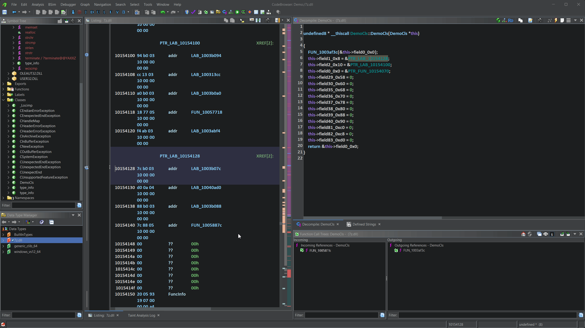

# DecompFuncUtils

A Ghidra extension that enhances the decompiler with C++ reverse engineering utilities, including VTable reconstruction, struct field navigation, and inter-procedural taint analysis.


---

## Installin The Plugin (Or Any Other Plugin)
- How to install the plugin you download from the releases.


## Features

### 🔷 Memory-to-Struct Converter
Select a memory region in the Listing view and instantly create a struct with automatic field naming based on symbol references.

**Capabilities:**
- Select any memory range containing pointers
- Automatically resolves pointer targets to symbols/functions
- Creates sanitized field names from referenced symbols
- Applies the new struct at the selection address



**Capabilities:**
- Right-click on a vtable label or DATA reference in the decompiler
- Automatically scans for valid function pointers (supports 32/64-bit)
- Creates a struct with fields named after target functions
- Handles duplicate function names with automatic suffixes
- Updates existing vtable structures when the table changes

### 🔷 Struct Field Navigation
Double-click or use `Ctrl+G` on struct field names in the decompiler to navigate directly to the referenced function or label.

**Use case:** When analyzing a vtable like `vtable->doSomething`, double-clicking on `doSomething` jumps directly to that function.

### 🔷 Data Flow Hover
Hover a variable, a called function's name, or an operator in the Decompiler to see what it is **affected by** and what it **affects** at that spot.

- **Affected by:** the named variables, constants, call results (`getenv()`), memory reads (`*ptr`) and caller-supplied arguments the value is computed from. Hovering a *read* shows the definitions that reach that particular use; hovering a declaration covers every use.
- **Affects:** the call arguments it is passed as (`memcpy() argument 3 (__n)`), memory it is stored to, the return value, branch conditions, and other variables it flows into.
- **may be modified by:** calls whose side effects can change a value that lives in memory.
- The header keeps what the hidden built-in popups would have said: the variable's data type and kind, or the callee's signature.

The search stays inside the current function, stops at the nearest named variable (hover that one to go further), and is bounded, so it never decompiles or blocks the UI. Enable the **DataflowDecompilerHoverPlugin** in *File → Configure*; turn the popup on or off under *Edit → Tool Options → Decompiler Popups → Data Flow Display*. Constants still show the scalar popup.

Agents get the same lists from the `ghidra_get_dataflow` MCP tool (see below).

---

## Installation

### From Release
1. Download the latest `.zip` from the [Releases](../../releases) page
2. In Ghidra: **File → Install Extensions → Add Extension**
3. Select the downloaded zip file
4. Restart Ghidra

### From Source
```bash
# Set your Ghidra installation path
export GHIDRA_INSTALL_DIR="/path/to/ghidra"

# Build the extension
gradle buildExtension
```

The built extension will be in `dist/`.

---

## Usage

### VTable Handler

1. In the Decompiler view, locate a constructor or function that references a vtable
2. Right-click on the vtable label (e.g., `PTR_LAB_10154100`)
3. Select **"Create/Update VTable Structure"**
4. Enter a name for the vtable struct
5. The plugin creates the struct and applies it at the vtable address

### Struct Field Navigation

- **Double-click** on any struct field name in the decompiler
- Or use **Ctrl+G** with the cursor on a field name
- The plugin navigates to the target function/label if found

### Memory-to-Struct Converter

1. In the Listing view, select a memory region (click and drag)
2. Right-click and select **"Create Struct from Selection"**
3. Enter a name for the new struct
4. The struct is created with pointer fields named after referenced symbols

---

## MCP Server (AI Agent Integration)

For per-data constants, variable lifetime splitting, per-use union fields, and
running scripts against the active program, see [MCP cleanup controls](docs/mcp-cleanup.md).

The plugin exposes Ghidra to AI agents over MCP. A **session manager** listens
on one fixed port (`13100`) from the moment Ghidra starts and gives every agent
session a CodeBrowser window of its own — see
[Session manager](#session-manager-one-fixed-port-13100). Each tool window also
keeps a direct port of its own (`13101` upward). Every port serves **both** MCP
transports, because different clients speak different ones:

| Endpoint | Transport | Used by |
|---|---|---|
| `POST /mcp` | Streamable HTTP (spec 2025-03-26+) | Codex, most modern clients |
| `GET /sse` + `POST /message` | Legacy HTTP+SSE (spec 2024-11-05) | Claude Code (`"type": "sse"`) |
| `GET /discovery` | Plain JSON status (not MCP) | launchers, health checks |

`initialize` negotiates the protocol revision: the server echoes the client's
requested version when it is one of `2024-11-05`, `2025-03-26`, `2025-06-18`,
and otherwise answers with the newest it supports.

### Linking imports to their shared objects

`ghidra_resolve_externals` attributes dangling `<EXTERNAL>` function symbols to
the project library that actually exports them, and stores the exporting address
in each external location so a call navigates straight into the library program.
(On Ghidra 12.3 `Library` is no longer a `Namespace`, so the attribution lives on
the external location and the symbol's parent namespace stays `Global`.)

```json
{"dryRun": true, "listSymbols": true}
```

```
{"program":"afpd","unresolvedBefore":337,"resolved":160,"withTargetAddress":160,
 "unresolvedAfter":177,
 "libraries":[{"name":"libatalk.so.18","path":"/pwnable.tw/CVE-2018-1160/libatalk.so.18",
               "status":"searched","resolved":160}]}
```

The `setAddress` half is still needed on current Ghidra: the stock resolver
attributes a namespace and never stores a target address, so even a successful
resolve leaves you unable to navigate from a call into the library.

The namespace half was needed because Ghidra's own **External Symbol Resolver**
was broken in 12.2 development builds before 17 Sep 2026 (fixed upstream, and in
the official 12.2 release). In `ExternalSymbolResolver.resolveSymbolsToLibrary`
it asked `isExportedSymbol(program, name)` where `program` is the binary being
repaired rather than the library — and `ExtLibInfo` never carried the library's
`Program` at all, because `getLibsToSearch` opened it only to record whether it
opens. The question asked was therefore "does `afpd` export `dsi_getsession`?",
which for an `UND` import is always no. On an affected build the import log
shows the libraries linking correctly and then resolving nothing:

```
  [libatalk.so.18] -> [/.../libatalk.so.18] (previously imported)
Resolving External Symbols of [/afpd] - Summary
	0 external symbols resolved, 338 remain unresolved
	[libatalk.so.18] -> /.../libatalk.so.18, 0 new symbols resolved
```

No import option changed this, since every option feeds the same predicate.
`tests/run_resolve_externals_test.ps1` reproduces it on a two-symbol ELF pair
and guards the behaviour either way.

Options: `dryRun` reports without changing anything; `setAddress` (default true)
stores the exporting address — Ghidra's own resolver does not, so even a working
resolve leaves you without cross-program navigation; `searchProject` (default
true) looks a library up in the project by file name when the import left it
unassociated, trying an exact name and then a prefix, which links a `DT_NEEDED`
of `libfoo.so.1` to a file imported as `libfoo.so.1.2.3`; `libraries` restricts
the work; `listSymbols` names what moved and what is left. It is idempotent —
re-run it as further dependencies are imported.

Prototypes are still not propagated: a resolved thunk reads
`undefined dsi_getsession()` until you give the external function a signature.
Ghidra does not carry signatures across programs in either direction.

### Cross-module references: seeing a library's callers

`ghidra_backlink_imports` makes an import navigable in **both** directions. Run
it on the importing program after `ghidra_resolve_externals`:

```json
{"dryRun": true, "listFunctions": true}
```

For every external function attributed to a project library it annotates the
exporting function *inside that library* with this program's call sites, and
bookmarks it under category `imported-by:<program>`:

```
[imported-by: afpd]
3 call sites in afpd (click to navigate):
  {@program /pwnable.tw/CVE-2018-1160/afpd@0010b2f4 afp_opensession+0x24}
  {@program /pwnable.tw/CVE-2018-1160/afpd@0010c110 dsi_stream_read+0x10}
[/imported-by: afpd]
```

**Why it is a comment and not an xref.** A Ghidra `Reference` is a from-address
and a to-address in *one* program's address factory, and the XRefs /
"Incoming References" field is built from that per-program table. There is no
cross-program reference storage, so no API can put an `afpd` call site into
`libatalk.so.18`'s incoming references — the field will stay as it is. Comment
annotations are the one link Ghidra does follow across programs:
`ProgramAnnotatedStringHandler` opens another project program and navigates to a
symbol or, failing that, a raw address. Any word after the target becomes the
rendered label, which is why a link reads `afp_opensession+0x24` rather than a
path. The bookmarks give the same set as one filterable list in the Bookmarks
window.

Call sites are found through the thunk chain — a call reaches a PLT thunk, which
thunks a stub in the synthetic `EXTERNAL` block, which thunks the external
location — so every thunk entry point is asked for its references, and the
thunk-to-thunk hops are filtered back out. Targets come from the external
location's stored address, or a name lookup in the library when no address was
stored (which is what the stock resolver leaves behind).

Each importing program owns a delimited block, so re-runs replace rather than
append and several importers of one library coexist; `remove` takes a block and
its bookmark out again. Options: `dryRun`, `remove`, `libraries`, `comments`,
`bookmarks`, `includeDataRefs` (link where the address is taken rather than
called), `maxCallSites` (default 25), `save`, `listFunctions`. Note that this
writes to and saves the **library** programs, not the current one.

If you would rather have real xrefs than annotations, the only way is one
program: import the executable, then File → Add To Program the library at a
non-overlapping base and re-point the PLT thunks with `setThunkedFunction`.
Incoming References then works natively and the decompiler follows calls into
library code, at the cost of a single merged database with no module separation.

### Function and stack-local refinement

Use `ghidra_set_function_no_return` to set or clear a function's non-returning
attribute without replacing its signature:

```json
{"name":"fatal_error","noReturn":true}
```

Provide `address` instead of `name` to select by address. Names must match exactly
and uniquely; namespace-qualified names and external functions are supported.
For thunks, Ghidra changes the ultimate target, reported as `targetFunction` and
`targetAddress`. Pass `noReturn: false` to clear the flag. Re-decompile callers to
see the updated control flow. This changes function metadata; it does not repair
existing listing bodies or instruction flow overrides.

Use `ghidra_replace_stack_variables` to replace fragmented stack locals with
typed arrays, structures, or pointers in one transaction:

```json
{
  "functionName": "buildRequestInfo",
  "dryRun": true,
  "variables": [
    {"name":"requestBuffer","dataType":"char[64]","stackOffset":"-0x80"},
    {"name":"requestInfo","dataType":"RequestInfo","stackOffset":"-0x100"}
  ]
}
```

Create `RequestInfo` first, and use offsets and sizes recovered from your function.
`ghidra_get_function` reports `noReturn`, numeric `stackOffset` values, and local
`firstUseOffset` values. Offsets are signed Ghidra stack coordinates, not raw
instruction SP/FP displacements. Supply an integer, decimal string, or signed
`0x` hex string. `functionAddress` takes precedence over `functionName`.

The preview returns `removedVariables` and `createdVariables`. Set `dryRun` to
`false` (the default) to apply. Every persisted stack local intersecting a new
range is removed in full, including partial overlaps and locals with different
first-use offsets. New locals have first-use offset zero. Unaffected locals and
parameters are preserved; overlaps with parameters or compound storage are
rejected. Requested ranges must not overlap, and names must be unique and must
not collide with unaffected variables. A failed edit rolls back the entire batch.
Decompiler-only locals need not be committed before replacement. Re-decompile
afterwards to check the recovered layout; this tool does not split variable lifetimes.

### Local data flow through MCP

`ghidra_get_dataflow` answers "what does this depend on, and what does it feed?"
inside one function, using the same analysis as the Decompiler's Data Flow hover:

```json
{"function":"cp","variable":"__n"}
{"address":"0x001000bc"}
{"function":"cp","address":"0x001000bc","variable":"dst"}
```

Give `variable` for every use of a decompiler variable, `address` for the call
(or store, return, branch, assignment) at that instruction, or both for that
variable as read or written there. The result has `affectedBy`, `affects` and
`mayBeModifiedBy`, each entry with a `kind` (`call result`, `constant`,
`memory read`, `call argument`, `return`, `branch`, `param`, `local`, ...), a
`text`, and usually an `address`. `maxDepth` (default 8) and `maxItems`
(default 50) bound the answer; `affectedByTotal`/`affectsTotal` and the
`*Truncated` flags say when something was cut. It does not cross calls or track
values through memory: use the taint tools for that.

### Taint analysis through MCP

Call `ghidra_taint_query` with a preset to start without writing the pattern DSL:

```json
{"preset":"tainted_copy_length","maxFunctions":100}
```

The UI and MCP share a curated preset catalog. `tainted_copy_length` and
`tainted_format` remain supported aliases.

| Preset | Reports |
|--------|---------|
| `memcpy_overflow`, `memmove_overflow`, `unbounded_copy_length` | Copy length derived from input; the `unbounded` variant also requires that the length is never bounds-checked, clamped, or a plain `strlen` |
| `strcpy_overflow`, `sprintf_overflow`, `gets_usage` | Unbounded string copy / formatting of input |
| `format_string`, `fprintf_format`, `snprintf_format`, `syslog_format` | Input used as a format string (`printf`, `vprintf`, `fprintf`, `vfprintf`, `dprintf`, `sprintf`, `vsprintf`, `snprintf`, `vsnprintf`, `syslog`) |
| `format_string_buffer`, `command_injection_buffer` | A buffer built with `sprintf`/`snprintf`/`strcpy`/`strcat`/… from input, then used as a format string or run as a command |
| `command_injection`, `popen_injection`, `exec_injection` | Input reaching `system`, `popen`, or the path of `execl`/`execlp`/`execle`/`execv`/`execvp`/`execve` |
| `winexec_injection`, `shellexecute_injection`, `createprocess_injection` | Input reaching `WinExec`, `ShellExecuteA/W`, `CreateProcessA/W` |
| `alloc_mul_overflow`, `alloc_add_overflow`, `realloc_mul_overflow` | `malloc($a * $b)` / `malloc($n + const)` with an input operand and no overflow or range check |
| `alloc_copy_mismatch`, `alloc_read_mismatch` | `$p = malloc($n)` then `memcpy`/`read` into `$p` with an input length that is neither derived from nor compared with `$n` |
| `unchecked_alloc_deref`, `unchecked_alloc_use` | Result of `malloc`/`calloc`/`realloc`/`strdup` dereferenced, or passed to a copy function, without ever being compared with NULL |
| `signed_length_copy`, `signed_length_alloc` | Signed input length reaching `memcpy`/`read`/`malloc`… with no check that rejects negative values |
| `unchecked_read_length` | Return value of `read`/`recv` used as a length without any check |
| `stack_buffer_const_overflow`, `stack_buffer_const_read` | Constant length larger than the fixed-size stack array it is copied or read into |
| `realloc_misuse` | `$p = realloc($p, $n)`: the only pointer is lost when `realloc` fails |
| `toctou_file_access` | `access`/`stat`/`lstat` on a path followed by `open`/`fopen`/`unlink`/`chmod`/… on the same path |
| `use_after_free`, `use_after_free_as_arg`, `use_after_free_as_arg2`, `double_free`, `double_free_like` | Memory lifetime patterns |
| `sql_injection` | Input reaching `sqlite3_exec`, `mysql_query`, `PQexec` |

Sink presets use `tainted_ext`: the data must come from a real input source
(`getenv`, `read`, `recv`, `fgets`, `scanf`, …) — directly, through the return
value of a wrapper that returns such data, or through a buffer that an earlier
call on the path filled (`read(fd, buf, n)`) or built from tainted data
(`sprintf(cmd, "ping %s", buf)`). Buffer contents are judged at the sink, in
program order: a write that happens after the sink does not taint it, and a
later `strcpy`/`sprintf` that always runs before the sink replaces what was
there. `tainted($v)` additionally treats **every parameter of the function** as
attacker controlled; use it in a custom query for a broader, noisier sweep. In
`main`, the parameters count as external input for both.

Copy-length queries require tainted **lengths**; a fixed-size copy of input data
alone is not reported. Format queries inspect the format argument, including
shifted arguments in fortified libc calls. Lifetime presets exclude constant
pointers, require CFG reachability between matched statements, and restrict
free-like or dereferencing calls to explicitly modeled APIs. Secure CRT `_s`
functions are not matched as ordinary libc functions with different signatures.
Wrapper returns require returned-value source evidence; merely calling an input
API inside a wrapper is insufficient.

These are investigation candidates, not proof of overflow or exploitability:
destination capacity, byte-wise buffer writes, writes made by callees, the
sufficiency of a bounds check, and branch predicate feasibility are not
modeled. `unchecked`, `bounded` and `overflow_checked` look for a comparison of
the value that decides a branch anywhere in the function; they do not prove the
check is correct or covers every path. Legacy exploratory templates (hardcoded
comparisons, parameter-to-sink sweeps, statement-level truncation patterns)
remain available by name through `query`, but are omitted from the default
selector and MCP presets. Use `ghidra_find_integer_truncation` for
allocation/copy width mismatches.

#### Pattern language

A query is `PATTERN name { statements } WHERE constraints`, or just one
statement with an optional `WHERE`. Statements are matched against the
decompiled function's p-code, **in control-flow order**: each statement must be
able to execute after the previous one, whether or not `...` separates them.
Anything the parser does not understand is an error.

| Statement | Matches |
|-----------|---------|
| `f($a, _, ...)` | A call. `$a` binds a value (a second use must be the same value), `_` is any argument, `...` any remaining arguments (`f(..., $x, ...)`: some argument). `$f(...)` binds the function name. FORTIFY wrappers (`__printf_chk`, …) are matched with the plain function's argument order. |
| `f(g($x), $a * $b, $n + 16)` | Nested calls and arithmetic arguments (`+ - * / % << >> & \| ^`, operands `$var`, `_`, numbers). Matched on the value's computation, so `n = strlen(s); p = malloc(n);` matches `malloc(strlen($s))`, and `x << 3` matches `$x * 8`. |
| `$p = f(...)`, `$s = $a * $b`, `$x = $y` | Assignment of a call result, a computed value, or a copy. |
| `*$p`, `*$p = $v` | Read or write through `$p`, including `$p->field` and `$p[i]`. |
| `$p == 0`, `$n < $max` | A comparison that decides a branch. |
| `char $buf[$n]` | A local array (`$n` is its size in bytes; `[_]` for any size). |
| `...`, `...{0,5}` | A gap; optionally at most N printed statements. |
| `... not:$p=_` | Gap in which `$p` is not reassigned on the path. |
| `... not:free($p)` | Gap in which that call (with those arguments) does not execute. |
| `... not:($p == 0)`, `... guard:($p == 0)` | Gap without / with a branch on that comparison. |
| `_` | Exactly one statement in between. |

| Constraint | Meaning |
|------------|---------|
| `tainted_ext($v)` | Tainted by a real input source (see above). |
| `tainted($v)`, `tainted($v, "read")` | Also treats parameters as sources / restricts to one named source. |
| `unchecked($v)` | The value never reaches a comparison that decides a branch (for pointers: a comparison with a constant such as NULL). Follows the value through copies, casts and phi nodes, so it does not depend on where the decompiler prints the check. |
| `bounded($v)` | The value reaches an ordered comparison (`<`, `<=`, …), or is a `min()`-style merge of bounded values. |
| `nonneg_checked($v)` | A branch rejects negative values (signed comparison with 0/1/-1, or any unsigned comparison). |
| `overflow_checked($a, $b)`, `overflow_checked($n)` | Every non-constant operand is bounded, or a division / carry test guards the computation. |
| `signed($v)` | The value is sign-extended, or is a variable of a signed integer type. |
| `same($a, $b)` | The same value, ignoring casts and integer extensions. |
| `related($a, $b)` | One is computed from the other, both read the same location or call the same function on the same arguments, or they are compared with each other. |
| `returned_by($v, "strlen", …)` | The value is (computed from) the result of one of these calls. |
| `const_eq($a, 16)`, `const_ne`, `const_lt`, `const_le`, `const_gt`, `const_ge` | Compare a constant binding with a number or another binding (unsigned). |
| `in_loop()`, `in_loop($v)` | The last matched statement / the statement that matched `$v` is inside a loop. |
| `function_in($f, "a", "b")`, `function_is($f, "a")` | The bound function name is one of these (wrapper prefixes ignored). |
| `flows_to($a, $b)`, `is_constant($v)`, `is_param($v)`, `is_local($v)` | Data flow and value kind. |

Combine constraints with `AND`, `OR`, `NOT` and parentheses. Examples:

```text
PATTERN cmd { snprintf($buf, _, ...); ...; system($buf); } WHERE tainted_ext($buf)
malloc($a * $b) WHERE tainted_ext($a) AND NOT overflow_checked($a, $b)
PATTERN nullderef { $p = malloc(_); ... not:$p=_; *$p; } WHERE unchecked($p)
PATTERN stack { char $buf[$size]; read(_, $buf, $len); } WHERE const_gt($len, $size)
```

Each match reports the first matched statement (`matchAddress`) and the last
one (`sinkAddress`, `sinkCode`), plus a `trace` with one line per matched
statement; `matchedCode` shows both ends.

Provide either `preset` or `query`, never both. To focus on one function:

```json
{"preset":"tainted_format","functionName":"fmt"}
```

For a custom source-specific query:

```json
{"query":"PATTERN p { printf($fmt); } WHERE tainted($fmt, \"getenv\")","maxFunctions":100}
```

For each page, inspect `functionsScanned` (attempted), `functionsAnalyzed`
(successful), and `failures` (addresses and reasons). When `truncated` is true,
pass `nextStartAfter` as `startAfter` with the same query and limit to continue.
Keep the program unchanged while paging. Retry failed functions individually
using `functionAddress`, optionally with a longer `decompileTimeout`.
`complete` reports coverage of the requested scope/page remainder; an empty
match list does not prove safety. Pointer writes, aliases, indirect calls, and
interprocedural source reachability remain approximate.

Use `ghidra_taint_forward` or `ghidra_taint_backward` with `functionName`,
`variableName`, and `maxDepth` to investigate a candidate further. Query results
include function and match addresses so you can decompile or navigate directly
to the finding using the existing MCP tools.

### Symbolic branch analysis and emulation

Use `ghidra_suggest_branch_flip` with a `branchAddress` to obtain concrete
witnesses for a local decompiler predicate. Supported shapes are same-width
integer comparisons against constants and masked equality/inequality.
`trueFeasible` and `falseFeasible` describe that predicate alone; an empty
witness list means that direction is impossible for the supported shape.
Witnesses use unsigned hex bit patterns, including signed negative values.
Width-changing casts, computed inputs, and masked inequalities return
`supported: false`. Earlier path constraints are not solved.

Use `ghidra_emulate_function` to verify candidates with seeded `registers`,
`memory`, and `stackPointer`. Enable `recordBranches` and `symbolicBranches`
to inspect the concrete path alongside decompiler expressions. `pcAtStop`
reports the final execution address, including when `maxSteps` is exhausted;
a breakpoint reached by the last allowed step takes precedence over the limit.
`branchCount` and `skippedCallCount` count all observations even when their
returned lists are truncated. Expression depth must be 1–64 and `maxSteps`
must be positive (capped at 2,000,000).

Re-emulate local branch witnesses to check reachability and machine-branch
direction. Skipped external calls do not model callee side effects.

The emulator also reports what a run silently depended on, and bounds it:

- `uninitializedReads` lists memory that was read before anything wrote it
  (address, size, and the instruction that read it). The emulator treats such
  bytes as zero, so this list is what to seed when a result looks wrong.
- `timeoutMs` (default 30000, max 600000) stops a run by wall clock with
  `stopReason: "timeout"`, for loops that would otherwise burn the step budget.
- `readMemory` takes up to 16 `{address, length}` ranges (length ≤ 1024) and
  returns their bytes at the stop point in `memoryAtStop`.
- `skipAllCalls` steps over every call, internal ones included, and
  `callReturnValues` supplies the value each skipped call returns, in execution
  order. This replays a witness that `ghidra_explore_paths` found with
  `callPolicy: "skip"`, and lets one function be run in isolation.

### Bounded symbolic path exploration

`ghidra_explore_paths` solves constraints across branches within one little-endian
x86/x64 function using the bundled Z3 solver. Supply an instruction `entry`,
`targetAddresses`, a concrete `stackPointer`, and named `symbolicInputs` in
registers or memory. Optional `registers` and `memory` provide concrete seeds;
`avoidAddresses` excludes paths reaching those instructions.

```json
{
  "entry": "00101000",
  "targetAddresses": ["00101030"],
  "stackPointer": "0x800000",
  "symbolicInputs": [{"name": "argument", "register": "EDI"}],
  "maxStates": 128,
  "timeoutMs": 10000
}
```

Replace the example addresses and argument register with those from your program.
For memory inputs, use `{"name":"buffer","address":"00700000","size":4}`
and seed the pointer register through `registers`. Symbolic input bytes override
concrete seeds. Ordinary unseeded registers start at zero; memory must come from
explicit seeds or initialized program bytes. PC and SP cannot be symbolic inputs.
Seed the return-address bytes at `stackPointer` if explored paths can execute
a return instruction; reading an uninitialized stack stops that path as incomplete.

The tool returns the first witness verified by Ghidra's concrete emulator, its
branch trace, and `emulateArguments` for `ghidra_emulate_function`. Targets stop
execution before the target instruction. `status: "found"` reports a verified
witness; `"exhausted"` with `complete: true` means no target is reachable within
the stated model and avoid scope. `"incomplete"` is not proof of unreachability.
`maxSolutions` (1–16) returns several witnesses, each on a different path;
`complete: true` alongside solutions means those are all the paths there are.

`replay.pathMatched` says whether the concrete run followed the same instruction
sequence the solver reasoned about. When it is `false` the inputs still reach the
target, but by another route, and `replay.divergedAt` says where they parted.

Two opt-in policies let exploration continue where it would otherwise stop. Each
trades soundness for reach, and each solution lists what it assumed:

- `callPolicy: "skip"` steps over every call and makes its return value a fresh
  unknown the solver may choose. The callee's writes to memory and to other
  registers are ignored. A witness lists the values it needs in `skippedCalls`
  (`assumedReturn` per call site), so it reads as "reachable *if* the callee can
  return this", not as proof.
- `uninitializedMemory: "symbolic"` turns each byte that has no seed and no
  program bytes behind it into an unknown, reported in `assumedMemory`; `"zero"`
  reads such bytes as 0. This gets past stack canaries, uninitialized locals and
  unseeded heap contents. The default, `"stop"`, ends the path.

Integer division and remainder are supported. Inputs that would fault (a zero
divisor, or the signed minimum divided by −1) are excluded from the path that
continues, and `divisionFaultPaths` counts the places where such inputs exist.

State, instruction, loop-visit, p-code operation, and solver/time limits bound the
search. Symbolic addresses, executable-memory writes, floating point, and other
unsupported operations terminate affected paths with diagnostics. Only one
exploration runs at a time; concurrent requests return `status: "busy"`.
The extension bundles Z3 and its native loader dependencies; native loading
failures are reported explicitly. Exploration does not modify the program.

### How Codex connects

Codex's MCP client (rmcp) supports **stdio and Streamable HTTP only — there is no
legacy SSE transport**. Pointing Codex at `/sse` fails before `initialize`: it
POSTs the handshake and `/sse` answers `GET` only, so the request is rejected
with `405 Method Not Allowed`. Codex must therefore use `/mcp`.

The committed `.codex/config.toml` does this:

```toml
[mcp_servers.ghidra]
url = "http://127.0.0.1:13100/mcp"
```

That is the session manager, so the URL stays valid across Ghidra restarts and
however many windows are open. Two caveats worth knowing:

- Codex reads a project's `.codex/config.toml` **only for trusted projects**.
  If `codex mcp list` doesn't show `ghidra`, accept Codex's "trust this folder?"
  prompt, or register it globally with
  `codex mcp add ghidra --url http://127.0.0.1:13100/mcp`.
- TOML has no environment-variable interpolation, so that port is literal. To
  pin Codex to one window's direct port instead of the manager, retarget per
  session with the launcher below or
  `codex -c mcp_servers.ghidra.url="http://127.0.0.1:13102/mcp"`.

The first time an agent calls a Ghidra tool, Codex asks you to approve it — that
approval prompt is normal and unrelated to the transport. (In `codex exec`,
which cannot prompt, MCP tool calls are auto-cancelled.)

### How Claude Code connects

Claude Code uses the legacy SSE transport via the committed `.mcp.json`:

```json
{ "mcpServers": { "ghidra": { "type": "sse",
  "url": "${GHIDRA_MCP_URL:-http://127.0.0.1:13100/sse}" } } }
```

The default is the session manager. Unlike Codex's config, this one *does*
interpolate, so setting `GHIDRA_MCP_URL` pins a session to one window's direct
port instead. Note that `/sse` is a long-lived stream: once open it stays open,
sending a `: keepalive` comment every 30s. **That is the healthy steady state,
not a hang** — responses to your `POST /message` calls arrive as `event: message`
frames on that stream.

### Session manager: one fixed port (13100)

The session manager runs in the Ghidra **Project window**, so it is listening as
soon as Ghidra is up — before any CodeBrowser exists — and it never moves to
another port. Every agent session uses the same URL
(`http://127.0.0.1:13100/sse` or `/mcp`), and the manager gives each one a
CodeBrowser window of its own:

- A session's first `ghidra_*` call binds it to a window no other session is
  using, preferring one that already has a binary loaded. If no window is open,
  the manager opens a CodeBrowser. The result of that first call says which
  window the session landed in.
- If every window is in use, the call fails and tells the agent to call
  `ghidra_session_open_window`, so a session never drifts into someone else's
  window by accident.
- All other `ghidra_*` tools then act on the bound window, exactly as they do
  on that window's direct port.

| Tool | What it does |
|---|---|
| `ghidra_session_status` | The window this session is bound to, plus every open window, its programs and how many sessions use it |
| `ghidra_session_open_window` | Open a new CodeBrowser (optionally on a program of the project) and move this session into it |
| `ghidra_session_attach` | Switch this session to an existing window, by name or direct port |
| `ghidra_session_release` | Give up this session's window; the window stays open |
| `ghidra_session_close_window` | Save the window's programs to the project and close the window (`save: false` discards changes instead) |

**Saving work.** `ghidra_open_program` saves the imported binary into the
project and opens it writable, then saves it again automatically when
auto-analysis finishes. `ghidra_save_program` saves later edits (renames, types,
comments) at any point, and `ghidra_session_close_window` saves everything open
in a window and closes it. Neither ever raises a Ghidra dialog: if a save cannot
happen yet (analysis still running, read-only file) the call fails and says why.

**Several windows from one session (parallel sub-agents).** Sub-agents share
their parent's MCP connection, so the manager sees them as one session with one
bound window. To let them work side by side, every forwarded `ghidra_*` tool
takes an optional `window` argument (a window name, or its direct port) that
runs that single call in the named window and leaves the binding alone:

1. The parent opens one window per sub-agent:
   `ghidra_session_open_window` with `{"name": "libfoo.so", "bind": false}`.
2. Each sub-agent is told its window and passes it on every call, e.g.
   `ghidra_decompile_function` with `{"name": "main", "window": "CodeBrowser(2)"}`.

Windows used this way count as in use, so other sessions are not bound into
them. All windows share Ghidra's single Swing thread: read-only analysis such as
decompiling runs in parallel across windows, while edits and other UI-bound
calls from different sub-agents take turns.

Things to know:

- **A Ghidra project must be open** for the manager to open windows. With only
  the Project window and no project, tool calls fail with that message.
- **A closed window is an error, not a move.** If a session's window closes, or
  its server is stopped from *Tools → MCP Server → Stop*, the session's calls
  fail until it attaches or opens a window itself. Moving it silently would aim
  its next edit at a different binary.
- **A silent session stops reserving its window after 30 minutes.** It stays
  bound; other sessions are simply allowed in again. This covers clients that
  exit without closing their session.
- **Windows are not closed by the manager.** Close them in Ghidra.
- **One Ghidra process owns the port.** A second Ghidra started alongside logs
  that `13100` is taken and runs without a manager; its windows are still
  reachable on their direct ports.

The manager loads on its own: it is a Project-window plugin in Ghidra's
*Utility* package, which every saved Project-window configuration already
includes. Its port, auth token and auto-start live in the Project window under
*Edit → Tool Options → MCP Session Manager*, and *Tools → MCP Session Manager*
has Start, Stop and Status. `curl http://127.0.0.1:13100/discovery` reports
`"role": "session-manager"` and the windows it routes to.

After updating the extension, each CodeBrowser shows Ghidra's **"New Plugins
Found!"** prompt once, because the extension gained a plugin. Answer it (No is
fine). While the prompt is up Ghidra cannot finish opening that window, so a
manager call that opens a window gives up after 45 seconds and says so.

### One server per tool window (13101–13150)

The unit of parallelism is the **Ghidra tool window**, not the Ghidra process.
Each window that carries the plugin runs its own MCP server on its own port and
serves *that window's* active program — so `CodeBrowser` and `CodeBrowser(2)` in
one Ghidra are two independent lanes for two agent sessions. This matters because
a Ghidra project is locked to a single process: several windows are the only way
to work on several binaries of the same project at once.

These direct ports sit beside the session manager and are for pinning a client
to one specific window. When a window's server starts it takes the first free
port beginning at the configured one (default `13101`, under *Edit → Tool Options
→ MCP Server*; `13100` belongs to the session manager), so the second window
lands on `13102`, the third on `13103`, and so on — across windows and across
processes alike. Each window advertises itself in
`~/.ghidra-mcp/server-<pid>-<port>.json` with its port, window name, project, and
loaded binaries; several files share a pid when one Ghidra hosts several windows.
Stale files (dead process, or a window that closed hard) are pruned on start.

*MCP Auto Start* is on by default, so a newly opened window claims a port by
itself — provided the plugin is part of the tool config you launch it from
(configure it once via *File → Configure*, then *File → Save Tool*).

```powershell
./tools/ghidra-claude.ps1 -List                      # every live window + port + binaries
curl http://127.0.0.1:13101/discovery                # one window's status
```

### Running multiple sessions in parallel

You can drive several binaries at once with no cross-talk, one agent session per
window. The simple way is the session manager: start as many agent sessions as
you like against `13100` and each gets its own window. The steps below are the
manual alternative, pinning each session to a window's direct port.

1. Add a lane. Any of:
   - **From Ghidra:** `Tools → MCP Server → New MCP Window` — opens another window
     on the current program, starts its server, and tells you its port.
   - **From an agent:** `ghidra_open_in_new_window` with a program name — opens
     that binary in a fresh window and returns the new port plus the attach
     command. `ghidra_list_windows` shows every lane and which one you are in.
   - **By hand:** open a second CodeBrowser from the project window
     (`Tools → Run Tool`, or double-click a second binary) — with auto-start it
     claims the next port on its own.
2. In a terminal, launch the agent bound to a specific window. PowerShell:

   ```powershell
   ./tools/ghidra-claude.ps1 -Binary libfoo.so                 # Claude -> window with libfoo.so
   ./tools/ghidra-claude.ps1 -Window 'CodeBrowser(2)'          # pick a window by name
   ./tools/ghidra-claude.ps1 -Client codex -Binary libfoo.so   # Codex  -> same window
   ./tools/ghidra-claude.ps1 -Port 13101                       # pin an exact port
   ./tools/ghidra-claude.ps1 -List                             # just list the live windows
   ```

   Or Bash (Linux/macOS/Git Bash — needs `curl` and either `jq` or `python`):

   ```bash
   ./tools/ghidra-claude.sh --binary libfoo.so
   ./tools/ghidra-claude.sh --window 'CodeBrowser(2)'
   ./tools/ghidra-claude.sh --client codex --binary libfoo.so
   ./tools/ghidra-claude.sh --port 13101
   ./tools/ghidra-claude.sh --list
   ```

   For Claude the launcher exports `GHIDRA_MCP_URL`; for Codex it passes
   `-c mcp_servers.ghidra.url=.../mcp`. Either way the agent starts in the same
   shell, bound to one window. Repeat in another terminal for another binary.

Each session gets its own port, its own window and that window's active program;
the `initialize` response tells the agent which window it landed in. Separate
Ghidra *processes* additionally isolate the JVM and the project database, so use
those for unrelated projects. Two sessions on the *same* program — whether via
two windows or two processes — is still not recommended: the database is
protected from corruption (EDT-serialized, per-call transactions), but the
sessions will logically overwrite each other's renames and structs. Pass
`closeHere: true` to `ghidra_open_in_new_window` to hand a program over to the
new lane instead of holding it in both.

Costs of sharing one process: all windows share one Swing event thread, so a long
mutating call in one window makes the others' GUI wait its turn, and a JVM crash
takes every lane with it.

### Troubleshooting: "server reachable but handshake fails"

Run the probe — it performs the real handshake on both transports and reports
each step:

```powershell
./tools/mcp-handshake-probe.ps1 -Port 13101      # both transports
./tools/mcp-handshake-probe.ps1 -Transport http  # just Codex's path
```

It resolves the target from `-Port`, `-Url`, `$env:GHIDRA_MCP_URL`, or the single
live server in `~/.ghidra-mcp`, and exits non-zero if any step fails. Common
outcomes:

| Symptom | Cause | Fix |
|---|---|---|
| `POST /mcp` → 404 or 405, `/sse` fine | Ghidra is running an older build with no `/mcp` endpoint | Close Ghidra, install the current extension, restart. The endpoint is created at server start, so restarting *just* the MCP server is not enough. |
| `POST /sse` → 405 | A Streamable HTTP client was pointed at the legacy endpoint | Use the `/mcp` URL for that client. |
| `/discovery` unreachable | Server not started, or wrong port | `Tools → MCP Server → Start`; confirm the port with `-List`. |
| `13100` refuses connections with Ghidra open | Session manager not running: port held by another Ghidra, or the plugin was unticked | Project window: `Tools → MCP Session Manager → Start`, or tick *MCP Session Manager* under `File → Configure → Utility`. |
| Client reports a timeout on `GET /sse` | The stream is *supposed* to stay open | Not a failure. Check for a real error on the `POST /message` side instead. |
| Handshake fine, tool call denied | Client-side approval prompt (Codex) | Approve the tool; in `codex exec` MCP calls are auto-cancelled. |
| Tools list, but calls fail with "No program is currently open" | Server is up before a binary is loaded | Open a program, or call `ghidra_open_program` first. |

Regression tests for both transports (in-process, against a real headless
Ghidra) live in `tests/`:

```powershell
./tests/run_headless_test.ps1 -Script McpTransportHeadlessTest.java
```

---

## Requirements

- **Ghidra** 11.0 or later
- **Java** 17 or later
- **Gradle** (version matching your Ghidra installation)

---

## License

This project is licensed under the Apache License 2.0 - see the [LICENSE](LICENSE) file for details.

---

## Author

**Tomer Goldschmidt**

---

